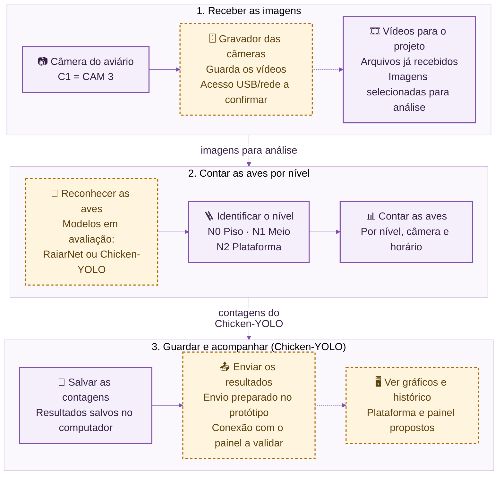

# Como funciona

O sistema recebe imagens das câmeras, processa quadros em um computador próximo ao aviário e envia os resultados para consulta. A seguir estão o fluxo proposto, as condições de captura e a separação entre piso, faixa intermediária e plataforma.

Para reproduzir a instalação, consulte [Captura e operação](tecnico/captura-operacao.mdx).

## Da câmera à consulta

1. A câmera ou o DVR fornece imagens ao dispositivo de processamento.
2. O dispositivo seleciona quadros e executa o modelo nas regiões configuradas para aquela câmera.
3. O resultado é guardado localmente e enviado ao backend, que o valida e registra no banco.
4. O painel consulta os dados disponibilizados pela API. A integração dos resultados e a geração de alertas estão descritas em [Como acompanhar pelo painel](painel.mdx).

Uma região não deve receber a configuração de outra câmera sem adaptação. Aves ocultas e regiões fora do enquadramento também limitam o que pode ser inferido. A arquitetura e a regra de contagem detalhadas estão abaixo.

A Figura 1 resume o caminho proposto e assinala as integrações que ainda precisam de teste.

**Figura 1: Caminho proposto entre a câmera e a consulta**

Fonte: produzido pela equipe, 2026

O diagrama se baseia nos fluxos documentados.  O histórico local e o sincronizador pertencem ao chicken_yolo; o desenho não indica que todos os modelos já seguem esse contrato. Diagrama produzido no Mermaid Live, exportado em SVG e convertido para PNG.

[Abrir imagem em tamanho original](/img/documentacao/fluxo-imagem-consulta.png). [Código Mermaid](/img/documentacao/fluxo-imagem-consulta.mmd).

## Arquitetura preliminar de medição por nível {#arquitetura-preliminar-arquitetura-preliminar-de-medição-por-nível}

Esta é a arquitetura de integração proposta, baseada nos componentes e resultados documentados até 16 de outubro de 2026. O piloto mede aves visíveis em N0 (piso), N1 (meio) e N2 (plataforma), por câmera e instante. A [separação dos níveis](funcionamento.mdx#niveis-e-regra-de-contagem-níveis-do-jump-start-e-regra-de-contagem) tem polígonos de trabalho para C1. A aprovação física das zonas, o acesso contínuo às imagens e a execução no hardware da Raiar ainda precisam de validação.

**Figura 2: da câmera à contagem das aves, em blocos e ícones**

Fonte: produzido pela equipe, 2026

Cada bloco representa uma etapa; o ícone ajuda a reconhecer sua função. Blocos amarelos tracejados indicam escolhas ou integrações a validar. Os vídeos recebidos são o ponto de partida dos testes. O histórico local pertence ao **Chicken-YOLO**; a RaiarNet ainda não grava nesse histórico.

**Figura 3: arquitetura para apresentação, em Mermaid editável**

Fonte: produzido pela equipe, 2026

A elaboração se baseou na [regra de níveis](funcionamento.mdx#niveis-e-regra-de-contagem-níveis-do-jump-start-e-regra-de-contagem), nos [resultados da RaiarNet](tecnico/raiarnet.mdx#contagem-por-nivel-contagem-de-aves-por-nível-e-resultados-do-modelo), no [detector Chicken-YOLO](tecnico/yolo.mdx#deteccao-de-aves-detecção-de-aves-com-yolo) e nos [requisitos](tecnico/requisitos.mdx#requisitos-requisitos-funcionais-e-não-funcionais). O gravador é o servidor de câmeras; selecionar imagens inclui extrair quadros e conferir sua qualidade. Cada modelo usa zonas próprias, e a terceira faixa se aplica ao Chicken-YOLO. C2 permanece uma vista complementar em avaliação.

Arquivos para apresentação: [Mermaid editável](/img/visao-computacional/arquitetura-apresentacao.mmd), [SVG vetorial](/img/visao-computacional/arquitetura-apresentacao.svg) e [PNG em alta resolução](/img/visao-computacional/arquitetura-apresentacao.png).

### Conexão com as câmeras {#arquitetura-preliminar-conexão-com-as-câmeras}

O relato técnico de 8 de outubro informa que as câmeras não têm entrada USB, mas o servidor de câmeras tem uma porta USB. Em 14 de outubro, a equipe registrou que precisaria conectar a solução ao servidor. Isso define o ponto físico de integração, mas não demonstra que a porta USB entrega um fluxo de vídeo, nem estabelece protocolo, permissão ou método de exportação. Os ensaios de software até aqui processaram vídeos e imagens em arquivos locais, como faz `src/chicken_yolo/capture.py`.

| Trecho | Situação documentada | Próxima verificação |
| --- | --- | --- |
| C1 (CAM 3) → servidor de câmeras | Equipamentos e gravações relatados pela Raiar | Identificar câmera, canal, horário e instalação no servidor |
| Servidor → arquivos locais | Vídeos recebidos e usados nos ensaios | Reproduzir a exportação com metadados e autorização de acesso |
| Porta USB do servidor → processamento local | Porta informada, transferência não testada | Verificar se exporta arquivos, se permite leitura automatizada e como preservar horário e ID da câmera |
| Servidor → processamento por rede | Alternativa técnica em aberto | Confirmar interface, protocolo, credenciais, disponibilidade e política de acesso |

Não há USB direto entre câmera e dispositivo de processamento no desenho. A escolha entre transferência pela porta USB e acesso por rede depende de teste com o servidor real.

### Separação dos níveis {#arquitetura-preliminar-separação-dos-níveis}

- **N0, piso:** contar diretamente as aves atribuídas ao polígono do piso. Aves pequenas e agrupadas no fundo geraram subcontagem no teste da RaiarNet.
- **N1, meio:** contar diretamente no polígono intermediário. Grade, sombra e mesa ocultam aves; não calcular N1 por diferença.
- **N2, plataforma:** contar diretamente no polígono superior. A borda distante pode ficar fora do campo útil, sobretudo à noite.
- **Fora dos polígonos:** registrar fora do escopo da C1 ou sem nível atribuível, conforme o modelo. A região azul das mesas móveis não é uma seção fechada.

A divisória verde fornece uma referência física fixa no fundo da vista; as mesas da região azul mudam com o manejo. Os polígonos da C1 são calibração para um enquadramento e uma configuração, não fronteiras permanentes do aviário. Mudança de câmera, recorte, resolução ou mesas exige revisar a versão das zonas antes de comparar períodos. A RaiarNet usa `src/raiarnet/configs/cameras/c1-jump-start.json`; o Chicken-YOLO tem regra e configuração próprias em `src/chicken_yolo/zones.py`. Um arquivo de zonas não deve ser aplicado ao outro sem verificar coordenadas, atribuição e versão.

Cada medição deve preservar câmera, quadro/instante, lote quando conhecido, modelo e versão, versão de zonas, qualidade e contagem por nível. Câmeras com campos sobrepostos não têm contagens somadas. C2 é uma vista complementar proposta; sua responsabilidade por nível depende de calibração e testes próprios. A [imagem com os três níveis](funcionamento.mdx#niveis-e-regra-de-contagem-níveis-do-jump-start-e-regra-de-contagem) ilustra a nomenclatura e não substitui essa calibração.

### Estado dos componentes {#arquitetura-preliminar-estado-dos-componentes}

- **Câmeras e gravações:** vídeos C1 (CAM 3) e CAM 16 foram usados em ensaios. A conexão planejada passa pelo servidor de câmeras, cuja porta USB foi relatada; forma de transferência, protocolo, retenção, relógio, exportação e relação entre IDs ainda precisam ser confirmados.
- **RaiarNet:** `src/raiarnet/models/`, `preprocessing/roi.py` e o [teste em 7 quadros](tecnico/raiarnet.mdx#contagem-por-nivel-contagem-de-aves-por-nível-e-resultados-do-modelo) mostram um protótipo medido em uma câmera e um dia. Ainda não há homologação em outros lotes ou na Raspberry Pi.
- **Chicken-YOLO e histórico local:** `src/chicken_yolo/` contém pipeline, zonas, SQLite e cliente de sincronização. O [piloto CAM16 com pesos pré-treinados](tecnico/yolo.mdx#piloto-video-raiar-piloto-com-o-vídeo-da-raiar) não produziu contagem útil.
- **PIOFlow e YOLOPIO:** [experimentos com base PIO](tecnico/pio.mdx#deteccao-e-contagem-de-galinhas-detecção-e-contagem-de-galinhas-em-imagens); não demonstram conexão com as câmeras da Raiar.
- **Receptor, histórico central e painel:** os [requisitos RF07 e RF08](tecnico/requisitos.mdx#requisitos-requisitos-funcionais-e-não-funcionais) os propõem. O cliente de envio local não comprova receptor ou painel implantado.
- **Raspberry Pi 4, 4 GB:** hardware alvo dos [RNF11 e RNF12](tecnico/requisitos.mdx#requisitos-requisitos-funcionais-e-não-funcionais). Latência, CPU, memória, temperatura e operação contínua exigem ensaio real.

Os modelos são candidatos separados. A escolha do modelo de produção, o contrato comum de saída e o lugar do processamento são decisões futuras. O histórico local e a sincronização implementados pertencem ao Chicken-YOLO; a RaiarNet ainda não escreve nesse mesmo contrato.

### Próxima sprint: verificações em duas semanas {#arquitetura-preliminar-próxima-sprint-verificações-em-duas-semanas}

- **Semana 1:** selecionar poucos quadros diurnos e noturnos dos vídeos já recebidos e anotar aves visíveis em N0, N1 e N2.
- **Semana 1:** rodar o protótipo disponível nesses quadros e registrar, por nível, a contagem obtida, a contagem anotada e os casos de oclusão.
- **Semana 2:** resumir os erros em uma tabela curta e separar imagens que mostrem as dúvidas sobre N1, a borda de N2 e a possível utilidade de C2.
- **Confirmar em validação com a Raiar:** a identificação de C1 (CAM 3) e CAM 16, os limites dos níveis quando as mesas mudam e como obter vídeos pelo servidor. Levar as imagens e perguntas preparadas, sem depender de uma visita à granja durante a sprint.
- **Fechamento da sprint:** ajustar os polígonos e este diagrama somente com o que for confirmado; registrar as dúvidas restantes e o próximo teste possível com os vídeos disponíveis.

Este desenho não permite inferir o total de aves do lote, diagnosticar bem-estar ou recomendar manejo a partir da ocupação observada.

## Níveis do Jump Start e regra de contagem {#niveis-e-regra-de-contagem-níveis-do-jump-start-e-regra-de-contagem}

A regra de contagem começa pela definição do que cada câmera consegue observar. Esta seção registra a geometria do aviário, os esclarecimentos validados com a Raiar e a regra adotada no MVP. Os termos técnicos estão no [glossário](apoio/glossario.mdx#glossario-glossário-em-linguagem-simples).

**Figura 4: nomenclatura dos níveis no Jump Start**

Fonte: produzido pela equipe, 2026

A ilustração foi produzida a partir dos quadros das câmeras CAM 3 e CAM 16.  **C1 corresponde à CAM 3.** A sobreposição ilustra a nomenclatura e não comprova a calibração dos polígonos. A prévia da CAM 16 é de outra data e não representa uma captura simultânea à imagem principal.

### Geometria observada pela câmera C1 {#niveis-e-regra-de-contagem-geometria-observada-pela-câmera-c1}

A câmera C1 é a câmera lateral superior que gerou os vídeos `.mp4` recebidos (identificada como CAM 3 na sobreposição da imagem). Ela enxerga, em perspectiva, uma seção do corredor do Jump Start [1]: a plataforma de grade metálica à esquerda, a borda das mesas com aves sob ela e o piso de maravalha à direita, até a divisória do fundo. Os dois vídeos diurnos e noturnos de 29 de setembro mostram o mesmo enquadramento, o que confirmamos sobrepondo pilares e bordas das mesas nos dois horários.

A partir dessa leitura, definimos três níveis observáveis:

| Nível | Nome | O que a C1 enxerga | Confiabilidade da observação |
| --- | --- | --- | --- |
| N0 | Piso | Cama de maravalha entre a borda das mesas e a cortina lateral | Alta no primeiro plano; aves pequenas e aglomeradas no fundo |
| N1 | Meio / parcialmente oculto | Faixa sob a borda da plataforma, onde as aves usam o patamar intermediário | Média: sombra intensa e oclusão pelas barras e pela própria mesa |
| N2 | Plataforma | Superfície de grade da plataforma superior | Média de dia; à noite, parte das aves empoleiradas na borda distante sai do campo útil |

A Figura 5 mostra os polígonos usados pela RaiarNet sobre um quadro diurno e um noturno, além da máscara aplicada antes da inferência.

**Figura 5: regiões de interesse de N0, N1 e N2 na câmera C1 e máscara aplicada fora dos níveis**

Fonte: produzido pela equipe, 2026

### Divisória verde fixa e região azul móvel {#niveis-e-regra-de-contagem-divisória-verde-fixa-e-região-azul-móvel}

Nas imagens de referência das câmeras que recebemos, duas marcações sobre o quadro real da C1 orientam a delimitação das zonas, e o parceiro esclareceu o significado de cada uma.

A divisória verde, no fundo do corredor, corresponde a uma divisória física fixa da seção. Por isso, usamos essa divisória como limite geométrico fixo da região de interesse (ROI): os polígonos de N0, N1 e N2 terminam nela, e nenhuma ave além dela é contada pela C1. No arquivo `src/raiarnet/configs/cameras/c1-jump-start.json`, o segmento `divisoria` registra essa referência.

A região azul, no alto à esquerda do quadro, atrás da plataforma, não é uma divisória física fixa nem uma área fechada. Ali ficam as estruturas e mesas laterais e centrais, em diferentes níveis, cuja configuração e posição a equipe da Raiar altera ao longo da recria, conforme a idade das aves e o manejo adotado para estimular a movimentação vertical e a ocupação progressiva. As aves se deslocam horizontalmente entre essas áreas e a seção que observamos.

Esse esclarecimento orienta a medição. Primeiro, a região azul fica fora dos polígonos da C1: as aves vistas ali, ao fundo e atrás de pilares e barras, não pertencem a N0, N1 ou N2 desta câmera. Segundo, a borda entre N2 e a região azul é uma linha de medição, e não uma parede: aves a atravessam o tempo todo. Por isso, tratamos os polígonos de N1 e N2 como calibração versionada do enquadramento atual. Quando as mesas mudam de altura ou de posição, os polígonos precisam ser revisados, enquanto o limite do fundo continua o mesmo.

Nas referências iniciais, a plataforma chegou a ser chamada de N1 e a faixa sob a borda, de "área oclusa". Adotamos a nomenclatura consolidada no conceito de três câmeras: N0 para o piso, N1 para o meio parcialmente oculto e N2 para a plataforma.

### Por que descartamos N1 = total da seção − N0 − N2 {#niveis-e-regra-de-contagem-por-que-descartamos-n1--total-da-seção--n0--n2}

Consideramos calcular o nível intermediário subtraindo as contagens do piso e da plataforma de um total conhecido da seção. Descartamos essa conta por dois motivos.

O primeiro é que o total da seção não é estável. Como a região azul é aberta, as aves entram e saem horizontalmente da área enquadrada a todo momento. Nos 12 segundos de vídeo diurno que anotamos, a contagem de aves visíveis na ROI variou de 122 a 138, sem que nenhuma ave fosse adicionada ao lote; parte dessa variação vem de aves que atravessam a borda com a região azul e o fundo do corredor. Qualquer "total" fixo usado como referência estaria errado na maior parte dos instantes.

O segundo é que os erros se acumulam no nível intermediário. Se o total fosse 140 e o modelo deixasse de ver 10 aves ocultas no piso e 5 na plataforma, a diferença atribuiria essas 15 aves a N1. Em uma seção com cerca de 20 aves visíveis em N1, isso inflaria a contagem do nível em 75%, justamente no nível que mais interessa para avaliar a ocupação vertical. A conta por diferença transforma toda oclusão de N0 e N2 em ocupação fictícia de N1.

Por isso, medimos cada nível diretamente: uma ave só entra na contagem de N1 se o modelo a identificar dentro do polígono de N1.

### Regra adotada no MVP {#niveis-e-regra-de-contagem-regra-adotada-no-mvp}

Implementamos a regra em `src/raiarnet/preprocessing/roi.py` e `src/raiarnet/models/counter.py`:

1. Cada ave identificada é atribuída a um único nível pelo **centro do corpo** (o mesmo ponto que anotamos). Escolhemos o centro, e não a base da caixa, porque os pés ficam ocultos na maioria das aves aglomeradas ou atrás das barras.
2. Aves com centro fora dos três polígonos não são contadas pela C1.
3. Cada câmera responde apenas pelos níveis que observa com confiabilidade e gera **uma contagem por nível e instante**. As contagens de câmeras diferentes **não são somadas**, para não duplicar aves em áreas sobrepostas.
4. A câmera **C2** é uma vista complementar proposta para avaliar a região intermediária parcialmente oculta. Se for testada, terá polígonos próprios e resultados separados dos da C1, sem soma de campos de visão sobrepostos.

Essa regra deixa uma parte das aves fora da contagem. À noite, um grupo grande de aves se empoleira junto à borda distante da plataforma, na transição para a região azul, e o centro do corpo delas fica acima da linha de N2 vista pela C1. Nos quadros noturnos anotados, 26 das 47 aves visíveis estavam nessa situação e ficaram fora da ROI. Essa é uma limitação de ângulo, e não do modelo. Sem uma vista superior definida nesta arquitetura, a cobertura de N2 à noite continua uma lacuna a medir e resolver com a Raiar.

### Referências {#niveis-e-regra-de-contagem-referencias}

[1] VENCOMATIC GROUP. **Jump Start**. Disponível em: [https://www.vencomaticgroup.com/layers/jump-start](https://www.vencomaticgroup.com/layers/jump-start). Acesso em: 14 out. 2026.
