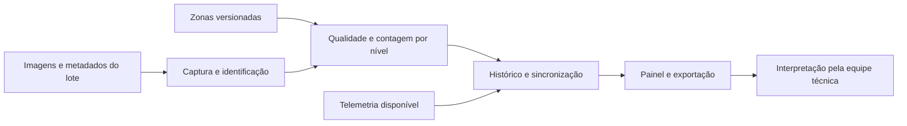
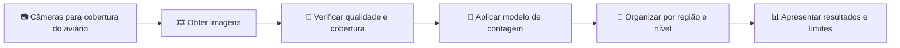

# A solução e seu escopo

O projeto usa imagens para acompanhar a distribuição das aves visíveis nos níveis do Jump Start durante a recria. As quatro páginas principais explicam a proposta, o funcionamento, os resultados e o painel. Os procedimentos de instalação e reprodução dos testes estão na referência técnica.

| Percurso principal | O que você encontra |
| --- | --- |
| **A solução e seu escopo** | Problema, contexto do aviário e proposta de cobertura, nesta página. |
| [Como funciona](funcionamento.mdx) | Caminho das imagens e regra de leitura dos níveis. |
| [Resultados e validação](resultados.mdx) | O que foi avaliado, em quais condições e com quais limites. |
| [Como acompanhar pelo painel](painel.mdx) | Interface disponível, demonstração e dados que dependem de integração. |

Os termos usados no projeto estão no [glossário](apoio/glossario.mdx). Os [perfis de uso](apoio/perfis.mdx), os [requisitos](tecnico/requisitos.mdx) e o [histórico](apoio/historico.mdx) complementam este percurso.

As seções abaixo preservam a proposta inicial e os ajustes de cobertura discutidos depois.

## O que buscamos acompanhar

A proposta é acompanhar a distribuição das aves visíveis entre piso, faixa intermediária e plataforma do Jump Start. A leitura depende de a câmera mostrar essas regiões com detalhe suficiente e de o modelo funcionar nas condições observadas. A contagem de aves visíveis não equivale ao total do lote.

O piloto deve conectar captura, processamento, armazenamento e consulta em um cenário delimitado. O desempenho dos modelos, o acesso às câmeras e a apresentação dos resultados precisam ser verificados em conjunto. As definições completas de escopo e cobertura estão nas seções seguintes.

## Proposta de solução {#proposta-de-solucao-proposta-de-solução}

Propomos analisar imagens para acompanhar a distribuição das aves visíveis entre os níveis do Jump Start durante uma parte definida da recria. Jump Start é o nome de um sistema de recria da Vencomatic. Ele tem linhas para oferecer ração e água e plataformas ajustáveis. Durante o crescimento, as aves aprendem a se deslocar entre os níveis e a usar os poleiros. Aviário é o galpão onde ficam as aves; Jump Start é o sistema instalado dentro dele. A descrição do sistema baseia-se na [página do fabricante](https://www.vencomaticgroup.com/layers/jump-start).

A análise de imagens por computador é chamada visão computacional. Neste projeto, ela serve para identificar e contar aves que aparecem nas imagens, não para enxergar o aviário inteiro. O [glossário](apoio/glossario.mdx#glossario-glossário-em-linguagem-simples) explica essa e outras expressões usadas nas páginas. A solução deverá guardar as contagens e os percentuais por nível para que a equipe técnica possa consultar a evolução por câmera, horário e idade do lote.

O primeiro protótipo funcional, ou produto mínimo viável (MVP), deve testar se essa medição é possível e útil com imagens reais da Raiar. A decisão sobre o manejo continuará com a equipe responsável. Antes de desenvolver a contagem, o grupo precisa confirmar a idade das aves, quais níveis serão observados e se as imagens permitem distingui-los.

### Público e valor esperado {#proposta-de-solucao-público-e-valor-esperado}

A equipe zootécnica e a gestão poderão consultar a distribuição das aves visíveis por nível, câmera e período para acompanhar a evolução do lote. O operador técnico deverá configurar a coleta e verificar a qualidade das imagens e eventuais falhas. O valor esperado é um histórico que permita comparar períodos; sua utilidade para decisões de manejo será avaliada com os usuários.

### Alternativas consideradas {#proposta-de-solucao-alternativas-consideradas}

A ocupação dos níveis pode continuar a ser observada diretamente ou registrada por contagem manual de uma amostra de imagens. A contagem manual servirá de referência para avaliar a medição automática. A automação poderá produzir um histórico por nível e horário se as imagens permitirem distinguir as aves e os níveis; caso contrário, será necessário ajustar o enquadramento da câmera ou reduzir a área analisada.

### Escopo do MVP {#proposta-de-solucao-escopo-do-mvp}

O recorte inicial proposto é um lote, um aviário e um campo de visão fixo, com os níveis observáveis e a janela de idade definidos com a Raiar. A quantidade de dispositivos prevista nos [requisitos](tecnico/requisitos.mdx#requisitos-requisitos-funcionais-e-não-funcionais) é uma meta de capacidade a testar separadamente, não evidência de cobertura de três aviários.

#### Funcionalidades incluídas {#proposta-de-solucao-funcionalidades-incluídas}

1. Identificar lote, aviário, câmera e instalação utilizada; configurar as zonas correspondentes aos níveis visíveis.
2. Receber imagens reais ou amostrar quadros em janelas definidas, preservando origem, horário e configuração.
3. Processar os quadros e estimar a quantidade de aves visíveis por nível, identificando cenas inadequadas e aves sem nível atribuível.
4. Calcular percentuais, armazenar resultados e versões e apresentar a evolução do mesmo lote por câmera.
5. Oferecer filtros, imagens representativas autorizadas, exportação CSV e indicação de lacunas ou falhas.
6. Associar telemetria ambiental ao período quando disponível e validada. A comparação temporal não demonstrará causalidade.
7. Controlar acesso e aplicar a retenção acordada para cada categoria de dado.

#### Fora do MVP inicial {#proposta-de-solucao-fora-do-mvp-inicial}

Identificação individual de aves; contagem do lote inteiro a partir de uma câmera; soma de câmeras com sobreposição; rastreamento de saltos e trajetórias; classificação automática de comportamento adequado; diagnóstico sanitário; recomendações de manejo; alertas de amontoamento; predição de desempenho; detecção de ovos de cama; integração com sistemas corporativos; instalação permanente em campo.

Comparação entre lotes, padrões esperados por idade e relação entre recria e produção são evoluções possíveis, descritas na [proposta da Raiar](https://github.com/AgroTech-Inteli-ATI/2026_02_Raiar/blob/4136a4ee882fc6b6619af90a4ee4cc7294403b6f/Arquivos/Proposta%20para%20avalia%C3%A7%C3%A3o%20de%20poss%C3%ADvel%20redirecionamento%20do%20projeto%20%282%29.docx). Exigem outro desenho de dados e validação. O MVP não emitirá conclusão sobre certificação ou bem-estar a partir da distribuição observada.

### Módulos e fluxo proposto {#proposta-de-solucao-módulos-e-fluxo-proposto}

O módulo de captura associa cada quadro à instalação e ao lote corretos. O processamento proposto ocorre no dispositivo local, conforme RF05 da versão inicial dos requisitos, com armazenamento temporário e sincronização posterior. A escolha definitiva do hardware e da frequência dependerá dos ensaios de capacidade. A plataforma concentra consulta, histórico e exportação.

O [dicionário de dados](tecnico/dados.mdx#dicionario-de-dados-dicionário-de-dados-e-coleta-inicial) define o significado de cada registro. Sua unidade básica de medição é um quadro, uma câmera, uma versão de zonas e um nível. Percentuais descrevem a distribuição das detecções com nível atribuível; aves sem atribuição aparecem separadamente. Não representam o percentual de todas as aves alojadas.

### Hipóteses, critérios e métricas {#proposta-de-solucao-hipóteses-critérios-e-métricas}

Os IDs da tabela relacionam cada hipótese aos dados e ao teste necessário para avaliá-la. As referências RF/RNF apontam para os [requisitos](tecnico/requisitos.mdx#requisitos-requisitos-funcionais-e-não-funcionais), cuja versão inicial foi consultada no commit `0aa9a71` [2], e precisarão ser revistas caso essa documentação mude.

| Hipótese e oportunidade | Decisão e requisito relacionado | Dados necessários | Critério de aceite proposto e métrica |
| --- | --- | --- | --- |
| H1: níveis e aves são distinguíveis nas imagens; oportunidade de medir ocupação | Testar zonas e contagem, RF03 e RF06, RNF08 | Imagens, zonas e contagens de referência | Dois anotadores conseguem aplicar o protocolo; reportar fração avaliável, divergência e erro por nível antes de fixar a meta |
| H2: o histórico facilita comparar períodos; oportunidade de apoiar análise | Painel por lote, idade e câmera, RF07 a RF09 | Resultados, datas e idade de referência | Usuário seleciona dois períodos, identifica o nível predominante e reconhece uma lacuna; registrar acertos, tempo e feedback |
| H3: a coleta é viável no dispositivo; oportunidade de manter continuidade | Processamento local e reenvio, RF04 e RF05, RNF01, RNF03 e RNF04 | Configuração, fila e registros de sincronização | Testar as metas preliminares de 24 h sem rede e três dispositivos; medir perdas, duplicações, fila e tempo de recuperação |
| H4: cada resultado pode ser explicado; oportunidade de revisar erros | Preservar origem e versões, RF07, RF09 e RNF10 | Quadro, zonas, modelo e status de qualidade | Todo resultado de teste remete às versões utilizadas; imagem só é recuperável dentro de sua retenção |

Para medir H1, será necessário um conjunto de teste anotado e separado do treino por sessão de captura. A avaliação deverá apresentar erro absoluto médio de contagem em aves, erro percentual agregado de contagem e diferença absoluta de distribuição em pontos percentuais, conforme as fórmulas do dicionário. As metas de 15% de erro de contagem e 10 pontos percentuais por nível vêm do RNF08 preliminar; dependem da concordância sobre a fórmula, da qualidade das imagens e da aprovação conjunta antes da avaliação final. Não são resultados já alcançados.

O comparador inicial será a contagem manual, com uma amostra revisada por dois anotadores. O tempo atual de análise e a existência de registros operacionais serão levantados na visita para estabelecer uma linha de base. Benefício operacional será avaliado com usuários; desempenho do modelo será avaliado com rótulos, sem confundir as duas medidas.

### Viabilidade, riscos e condições de revisão {#proposta-de-solucao-viabilidade-riscos-e-condições-de-revisão}

| Risco | Efeito | Resposta e condição para avançar |
| --- | --- | --- |
| Níveis sobrepostos na imagem ou aves ocultas | Contagem enviesada e atribuição ambígua | Inspeção com o parceiro; ajustar campo de visão ou reduzir zonas; não extrapolar para aves ocultas |
| Poucas idades, dias ou condições de luz | Histórico pouco representativo | Matriz de cobertura e pedido de novas amostras; declarar o recorte avaliado |
| Mudança de câmera ou estrutura | Quebra da comparação temporal | Nova instalação ou versão de zonas e marcação da mudança no histórico |
| Imagens atrasadas ou acesso indisponível | Atraso do modelo e da validação | Pactuar responsáveis e entregas; usar dados sintéticos apenas para testar o fluxo |
| Hardware e armazenamento insuficientes | Fila crescente ou descarte de quadros | Medir custo por quadro e volume diário antes de definir frequência e retenção |

Não há orçamento aprovado nem inventário confirmado nesta versão. O dimensionamento do protótipo requer levantar quantidade de dispositivos disponíveis, armazenamento, conectividade e horas de anotação, desenvolvimento e manutenção. O custo deverá reunir equipamentos, instalação, armazenamento, operação e horas de trabalho, distinguindo recursos já disponíveis de novas aquisições. Sem essas entradas, não há total financeiro ou economia defensável. A análise financeira detalhada permanece na etapa prevista pelo [roteiro de artefatos](https://github.com/AgroTech-Inteli-ATI/2026_02_Raiar/blob/4136a4ee882fc6b6619af90a4ee4cc7294403b6f/Arquivos/artefatos%20raiar1.pdf).

### Próximas validações {#proposta-de-solucao-próximas-validações}

| Frente | Próximo resultado a verificar |
| --- | --- |
| Proposta e pedido de dados | Escopo e pacote inicial revisados |
| [Canvas de Proposta de Valor](apoio/canvas.mdx#canvas-proposta-de-valor-canvas-de-proposta-de-valor) | Vínculo entre necessidades confirmadas e proposta |
| Personas e jornada | Evidência de quem configura, consulta e decide |
| Requisitos e metas de qualidade | Critérios coerentes com os dados disponíveis |
| Pesquisa sobre aviários europeus | Fontes e limites de transferência para a Raiar |
| Visita | Registro das respostas, pendências e prazos |
| Recorte e uso das imagens | Lote, idade, níveis, acesso e uso definidos com a Raiar |

A proposta deverá ser revista após a visita e a inspeção do primeiro pacote de imagens, antes do treinamento do modelo. Caso o Canvas ou a jornada indiquem outra necessidade prioritária, o recorte do MVP e o pedido de dados deverão ser reavaliados.

### Referências {#proposta-de-solucao-referencias}

[1] RAIAR ORGÂNICOS. **Proposta para avaliação de possível redirecionamento do projeto**. 2026. Documento interno, seções 3 a 10. Disponível em: https://github.com/AgroTech-Inteli-ATI/2026_02_Raiar/blob/4136a4ee882fc6b6619af90a4ee4cc7294403b6f/Arquivos/Proposta%20para%20avalia%C3%A7%C3%A3o%20de%20poss%C3%ADvel%20redirecionamento%20do%20projeto%20%282%29.docx. Acesso em: 24 set. 2026.

[2] AGROTECH INTELI. **Requisitos iniciais**. 2026. Versão do commit `0aa9a71`. Disponível em: https://github.com/AgroTech-Inteli-ATI/2026_02_Raiar/blob/0aa9a7107628c61197a883bf3c6f236193f99c7e/DOCUMENTACAO_REQUISITOS.md. Acesso em: 24 set. 2026.

[3] TAP AgroTech Raiar Orgânicos. 2026. Documento interno. Disponível em: https://github.com/AgroTech-Inteli-ATI/2026_02_Raiar/blob/4136a4ee882fc6b6619af90a4ee4cc7294403b6f/Arquivos/TAP_AgroTech_Raiar_Organicos.pdf. Acesso em: 24 set. 2026.

[4] ROTEIRO de artefatos: Raiar. 2026. Documento interno. Disponível em: https://github.com/AgroTech-Inteli-ATI/2026_02_Raiar/blob/4136a4ee882fc6b6619af90a4ee4cc7294403b6f/Arquivos/artefatos%20raiar1.pdf. Acesso em: 24 set. 2026.

Os documentos internos estão preservados no repositório privado do projeto.

## Proposta de solução e cobertura do aviário {#proposta-solucao-cobertura-proposta-de-solução-e-cobertura-do-aviário}

### Problema e objetivo {#proposta-solucao-cobertura-1-problema-e-objetivo}

Queremos testar a contagem de aves nas imagens disponíveis na Raiar. Isso exige acesso às gravações, detalhe suficiente nas regiões de interesse e um modelo capaz de trabalhar com essas imagens.

A recria e a produção acontecem em aviários distintos. Na recria, as pintainhas crescem e a disposição das aves e das estruturas muda ao longo do tempo. Em alguns momentos, elas podem estar muito próximas umas das outras ou parcialmente encobertas. Vamos avaliar a capacidade das câmeras e do modelo de distinguir e contar as aves em cada fase.

Na produção, o ambiente e a disposição das aves também precisam ser avaliados com suas próprias imagens e câmeras. Cada aviário será avaliado de acordo com suas condições de imagem e cobertura.

O objetivo é testar o caminho entre a câmera e a contagem e identificar onde as imagens atuais bastam. Onde faltar detalhe ou cobertura, será preciso avaliar outro posicionamento ou outra forma de captura.

### Contexto dos aviários {#proposta-solucao-cobertura-2-contexto-dos-aviários}

#### Recria {#proposta-solucao-cobertura-recria}

Na recria, as pintainhas crescem e passam a ocupar diferentes regiões da estrutura. A imagem abaixo ilustra a separação de níveis utilizada nos testes existentes: N0 no piso, N1 na faixa intermediária e N2 na plataforma.

<strong>Figura 1: níveis do aviário de recria nas imagens das câmeras</strong>

Fonte: produzido pela equipe, 2026

A ilustração foi produzida a partir dos quadros das câmeras CAM 3 e CAM 16.  A prévia da CAM 16 é de outra data e não representa uma captura simultânea à imagem principal.

A disposição das estruturas pode mudar durante a recria. As regiões de contagem serão ajustadas conforme o posicionamento das estruturas e o enquadramento das câmeras.

#### Situações registradas na visita {#proposta-solucao-cobertura-situações-registradas-na-visita}

Durante a visita, gravamos dois vídeos com um iPhone 15 Pro Max próximo às aves: um de cerca de 21 segundos, com pintainhas mais dispersas, e outro de cerca de 34 segundos, com uma concentração maior. Nos quadros examinados, o primeiro mostra aves separadas no piso e outras próximas à estrutura; no segundo, há forte agrupamento e sobreposição entre pintainhas.

<strong>Figura 2: pintainhas dispersas e agrupadas na visita à Raiar</strong>

| Pintainhas mais dispersas | Pintainhas mais agrupadas |
| :---: | :---: |
|  |  |
| Vídeo de 21 segundos, quadro aos 8 segundos | Vídeo de 34 segundos, quadro aos 8 segundos |

Fonte: produzido pela equipe, 2026

Os quadros foram extraídos dos vídeos gravados pela equipe durante a visita à Raiar, em 28 de outubro de 2026.

Essas imagens serão usadas para verificar em quais condições conseguimos contar as pintainhas e acompanhar sua distribuição entre as regiões e níveis do aviário. A identificação dos níveis exige também que cada área esteja visível e corretamente delimitada na imagem.

As gravações foram feitas próximas às aves. Para uma câmera instalada no alto do aviário, precisamos verificar no local a distância, a altura, o enquadramento e o tamanho das pintainhas na imagem. O teste pode considerar uma distância de 3 a 5 metros entre a câmera e as pintainhas. Uma lente com campo de visão adequado ou zoom óptico pode aproximar uma região, mas é necessário comparar o detalhe obtido com a área que deixa de aparecer. Ampliar digitalmente um recorte não recupera detalhes que a câmera não capturou.

#### Produção {#proposta-solucao-cobertura-produção}

O aviário de produção tem suas próprias estruturas, circulação de aves e câmeras. Vamos examinar as imagens da produção para definir as regiões de interesse e a forma de contagem adequada ao aviário.

#### Lote e boxes {#proposta-solucao-cobertura-lote-e-boxes}

O lote ocupa o aviário, e a equipe da Raiar pode organizar esse espaço em boxes por meio dos portões. Com os portões abertos, o lote pode ocupar um único box, incluindo a área ao redor das estruturas ou apenas a área interna, conforme a configuração adotada. O mesmo espaço também pode ser dividido em dois ou mais boxes.

Para visualizar a proposta, consideramos a área interna das aves com cerca de 64 m × 12 m, além de aproximadamente 2 m ao redor. Uma divisão transversal em dois boxes corresponde a cerca de 32 m × 12 m por box. Uma divisão adicional poderia formar quatro áreas de aproximadamente 32 m × 6 m, mas a proposta prioriza o cenário de dois boxes e o aviário completo.

#### Imagens e câmeras existentes {#proposta-solucao-cobertura-imagens-e-câmeras-existentes}

As câmeras existentes apresentam enquadramentos e zoom que não permitem obter imagens adequadas à contagem das pintainhas. A documentação dos testes identifica a vista C1 como CAM 3 e também registra testes com a CAM 16.

A ficha fotografada na visita indica área de piso de 3.240 m² para o aviário 19. A identificação e as dimensões do espaço a monitorar serão conferidas com a planta.

### Proposta de solução {#proposta-solucao-cobertura-3-proposta-de-solução}

#### Caminho da imagem até o resultado {#proposta-solucao-cobertura-caminho-da-imagem-até-o-resultado}

As câmeras atuais não cobrem uma área suficiente para contar as pintainhas e fornecer imagens adequadas ao modelo. A solução inclui definir o posicionamento e o enquadramento de câmeras que ampliem essa cobertura. O acesso às imagens e o local de processamento serão definidos nos testes de implementação.

#### Posicionamento e cobertura {#proposta-solucao-cobertura-posicionamento-e-cobertura}

A análise das câmeras existentes identificou que a cobertura atual é insuficiente para a contagem das pintainhas. A proposta é posicionar câmeras adicionais para ampliar a área observada e obter imagens adequadas ao modelo.

Propomos como estimativa inicial quatro câmeras superiores ao longo da linha central da área das aves, voltadas para baixo e distribuídas para observar trechos consecutivos. A quantidade e o espaçamento serão confirmados pelos testes de cobertura e qualidade das imagens.

#### Piloto em um box {#proposta-solucao-cobertura-piloto-em-um-box}

Para testar o MVP em condições reais, propomos usar um dos dois boxes, com aproximadamente 32 m × 12 m, em vez de começar pelo aviário inteiro. Nesse trecho, a estimativa inicial é de duas câmeras superiores, distribuídas ao longo da linha central. Assim, podemos testar a obtenção das imagens, a cobertura e a contagem das pintainhas em uma área delimitada.

O primeiro teste continua sendo aplicar o modelo aos vídeos da visita, com pintainhas dispersas e agrupadas. Se a contagem individual funcionar, o piloto em um box permitirá verificar o fluxo com câmeras instaladas. Caso contrário, investigaremos outro método de contagem antes de expandir a solução. Para o aviário completo, mantemos a estimativa inicial de quatro câmeras; as quantidades dependem da cobertura obtida nos testes.

<strong>Figura 3: proposta de câmeras superiores na área das aves</strong>

<svg viewBox="0 0 1000 480" role="img" aria-label="Planta esquemática do aviário e da área das aves, com dois boxes e quatro câmeras superiores estimadas na linha central. As duas primeiras correspondem ao piloto em um box." width="100%" xmlns="http://www.w3.org/2000/svg">
  <rect x="60" y="65" width="880" height="350" rx="12" fill="#f4f7f8" stroke="#254e68" strokeWidth="4" />
  <text x="500" y="42" textAnchor="middle" fill="#254e68" fontSize="23" fontWeight="bold">AVIÁRIO · VISTA SUPERIOR</text>
  <text x="500" y="120" textAnchor="middle" fill="#254e68" fontSize="19">≈ 2 m ao redor da área das aves</text>
  <rect x="150" y="145" width="700" height="190" rx="5" fill="#fff1c9" stroke="#c08800" strokeWidth="3" />
  <text x="500" y="184" textAnchor="middle" fill="#664b0a" fontSize="22" fontWeight="bold">ÁREA DAS AVES</text>
  <line x1="500" y1="145" x2="500" y2="335" stroke="#c08800" strokeWidth="3" strokeDasharray="8 8" />
  <text x="325" y="215" textAnchor="middle" fill="#664b0a" fontSize="16">BOX PARA O PILOTO</text>
  <text x="675" y="215" textAnchor="middle" fill="#664b0a" fontSize="16">OUTRO BOX</text>
  <line x1="180" y1="245" x2="820" y2="245" stroke="#126c84" strokeWidth="2" strokeDasharray="8 8" />
  <circle cx="235" cy="245" r="27" fill="#126c84" /><text x="235" y="252" textAnchor="middle" fill="white" fontSize="20" fontWeight="bold">1</text>
  <circle cx="410" cy="245" r="27" fill="#126c84" /><text x="410" y="252" textAnchor="middle" fill="white" fontSize="20" fontWeight="bold">2</text>
  <circle cx="590" cy="245" r="27" fill="#126c84" /><text x="590" y="252" textAnchor="middle" fill="white" fontSize="20" fontWeight="bold">3</text>
  <circle cx="765" cy="245" r="27" fill="#126c84" /><text x="765" y="252" textAnchor="middle" fill="white" fontSize="20" fontWeight="bold">4</text>
  <text x="500" y="310" textAnchor="middle" fill="#664b0a" fontSize="18">Câmeras acima das aves, voltadas para baixo</text>
  <text x="500" y="385" textAnchor="middle" fill="#254e68" fontSize="18">1 e 2: piloto em um box · 3 e 4: expansão estimada</text>
  <text x="500" y="455" textAnchor="middle" fill="#254e68" fontSize="17">Quantidade e espaçamento sujeitos ao teste de cobertura</text>
</svg>

Fonte: produzido pela equipe, 2026

O desenho se baseia nas informações da visita.  Planta esquemática, sem escala.

Como referência inicial, considerar câmeras a aproximadamente 3 a 5 metros das aves, com lentes ajustadas para distinguir as pintainhas e observar os trechos previstos. A visão superior será avaliada também quanto à visibilidade dos níveis inferiores sob as estruturas; se houver bloqueio, uma vista complementar poderá ser necessária.

Para dimensionar a instalação, medir em uma imagem de teste o comprimento e a largura em que as pintainhas podem ser distinguidas. Dividir o comprimento a cobrir pelo comprimento útil observado e arredondar para cima; ajustar a quantidade considerando a largura, as sobreposições e os obstáculos. A planta e os testes permitirão posicionar as câmeras sobre a estrutura real.

Áreas vistas por mais de uma câmera devem ser identificadas. Uma mesma ave pode aparecer em duas imagens, por isso as contagens dessas áreas não podem ser simplesmente somadas. Primeiro será necessário definir a responsabilidade de cada vista ou testar uma forma de reconciliar as contagens.

#### Modelo e contagem {#proposta-solucao-cobertura-modelo-e-contagem}

Usar os modelos já desenvolvidos como ponto de partida e avaliá-los com imagens reais de cada situação. A RaiarNet já foi testada em quadros da CAM 3 com contagem por nível; o teste registrado utilizou sete quadros. Em um piloto anterior da CAM 16, o detector pré-treinado avaliado não produziu contagem útil. Esses resultados orientam a escolha das próximas imagens e configurações a testar.

Na recria, comparar imagens de pintainhas pequenas e de aves em fases posteriores, incluindo momentos de maior concentração. Quando for possível distinguir as aves, comparar a saída do modelo com a contagem manual da mesma região. Se a imagem não permitir uma referência manual confiável, registrar a limitação e testar outra vista ou enquadramento antes de atribuir o problema apenas ao modelo.

Na produção, repetir a avaliação com imagens representativas desse aviário. A contagem será apresentada por região visível e, quando fizer sentido e houver definição validada, por nível. Uma contagem de aves visíveis em uma região não representa automaticamente o total do aviário.

#### Apresentação dos resultados {#proposta-solucao-cobertura-apresentação-dos-resultados}

Para cada resultado, apresentar a câmera, a data ou o instante disponível, o aviário, a região observada, o modelo utilizado e a contagem. Indicar quando a visibilidade for parcial ou a contagem ainda não tiver sido validada. O formato da consulta ou painel será definido conforme a utilidade para a Raiar e os recursos disponíveis.
