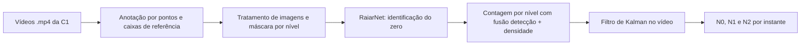

# Resultados e validação

Cada experimento avaliou uma tarefa: detectar aves, estimar a contagem por nível ou localizar grupos. As imagens e as referências manuais também mudam entre testes. Por isso, os números não permitem uma comparação direta entre todos os modelos.

| Abordagem | O que foi investigado | Onde conferir a evidência |
| --- | --- | --- |
| RaiarNet | Identificação e contagem direta por nível na câmera C1. | [Resultados, referências manuais e limitações](tecnico/raiarnet.mdx#contagem-por-nivel-resultados-no-teste). |
| Detector YOLO | Uso de um detector e testes nas imagens recebidas da Raiar. | [Piloto e reprodução do detector](tecnico/yolo.mdx). |
| PIOFlow e YOLOPIO | Treino na base PIO e adaptação de contagens às imagens da Raiar. | [Experimentos e pós-processamento](tecnico/pio.mdx). |
| YannET | Segmentação de pintinhos e localização de regiões agrupadas na CAM 7. | [Ensaio, imagens e limites](tecnico/yannet.mdx). |

A contagem da RaiarNet foi comparada com referências manuais em um conjunto pequeno de quadros. O ensaio do YannET produz máscaras e regiões candidatas; isso não equivale a uma contagem individual validada. No YOLOPIO, a comparação com cerca de 130 aves ao longo do vídeo deve ser distinguida da avaliação nos seis quadros anotados: a primeira usa uma referência aproximada, não uma contagem manual de todos os quadros.

Os números publicados pertencem às condições descritas em cada experimento. Não demonstram, por si só, desempenho em qualquer câmera, fase de recria ou equipamento.

Abaixo estão as abordagens estudadas e a síntese da RaiarNet. Os detalhes de treino, comandos e gráficos estão nas páginas técnicas.

## Como ler as saídas dos modelos

As Figuras 1 a 3 mostram saídas já registradas nos experimentos. Elas ilustram o que cada abordagem entrega; não formam uma comparação controlada de desempenho.

**Figura 1: RaiarNet: regiões por nível e previsões em dois quadros**

Fonte: produzido pela equipe, 2026

A imagem reúne resultados já documentados no ensaio da RaiarNet.  As cores delimitam os níveis e as caixas mostram previsões, sujeitas aos erros medidos no conjunto de teste.

[Abrir imagem em tamanho original](/img/visao-computacional/predicoes-raiarnet-teste.png).

A referência manual, as métricas e as limitações estão em [RaiarNet: método e reprodução](tecnico/raiarnet.mdx#contagem-por-nivel-resultados-no-teste).

**Figura 2: YOLOPIO: saída original e após o pós-processamento**

Fonte: produzido pela equipe, 2026

A imagem apresenta o experimento de pós-processamento registrado pela equipe.  O aumento de caixas não comprova maior acerto: aves perdidas e falsas detecções podem compensar-se na contagem.

[Abrir imagem em tamanho original](/img/pos-processamento/antes-depois-dia.png).

O protocolo de ajuste e a avaliação nos quadros anotados estão em [PIOFlow e YOLOPIO](tecnico/pio.mdx).

**Figura 3: YannET: regiões candidatas de agrupamento na CAM 7**

Fonte: produzido pela equipe, 2026

O ensaio utilizou a foto de referência da CAM 7 e o SAM 3 pré-treinado, sem ajuste dos pesos.  As caixas delimitam regiões propostas pelo algoritmo, não aves individuais nem alertas validados.

[Abrir imagem em tamanho original](/img/yannet/cam7-caixas-candidatas.jpg).

Os parâmetros, o tempo de execução e os limites desse ensaio estão em [YannET: segmentação e agrupamentos](tecnico/yannet.mdx).

## Modelos de detecção e contagem de aves {#index-modelos-de-detecção-e-contagem-de-aves}

Na Sprint 2, a equipe desenvolveu três abordagens para identificar aves em imagens e vídeos da Raiar. Cada uma tem documentação própria, mantida como foi produzida por seu responsável. Esta página apenas as aproxima para consulta.

| Modelo | Abordagem | Dados usados | Documentação |
| --- | --- | --- | --- |
| RaiarNet | Rede escrita do zero em PyTorch, com contagem direta nos níveis N0, N1 e N2 | Vídeos da Raiar, anotados pela equipe | [Modelo de visão computacional](resultados.mdx#index-modelo-de-visão-computacional-construído-do-zero) |
| Detector de aves (`chicken_yolo`) | YOLO11 pré-treinado (PoultryVision e COCO), com inferência, avaliação e integração | Vídeos da Raiar, com opção de dataset próprio | [Detecção de aves com YOLO](tecnico/yolo.mdx#deteccao-de-aves-detecção-de-aves-com-yolo) |
| PIOFlow e YOLOPIO | Rede experimental em TensorFlow/Keras com pesos aleatórios e YOLO11n ajustado | Base pública PIO (Zenodo) | [Detecção e contagem de galinhas](tecnico/pio.mdx#deteccao-e-contagem-de-galinhas-detecção-e-contagem-de-galinhas-em-imagens) |

Os resultados quantitativos de cada página foram obtidos em dados e protocolos diferentes. Por isso, não são diretamente comparáveis entre si. Os termos técnicos estão no [glossário](apoio/glossario.mdx#glossario-glossário-em-linguagem-simples).

## Modelo de visão computacional construído do zero {#index-modelo-de-visão-computacional-construído-do-zero}

Construímos do zero um modelo para identificar aves e contá-las diretamente em cada nível do Jump Start (N0 · piso, N1 · meio e N2 · plataforma) nas imagens da câmera C1. Partimos dos vídeos `.mp4` reais recebidos da Raiar, sem nenhuma imagem anotada e sem pesos pré-treinados.

O código fica em `src/raiarnet/` (`labeling`, `preprocessing`, `models`, `training`, `evaluation` e `baseline`) e os comandos `python -m` desta seção são executados de dentro dessa pasta; os dados, quadros, pesos e resultados de execução ficam fora do Git. Os termos técnicos estão no [glossário](apoio/glossario.mdx#glossario-glossário-em-linguagem-simples).

No teste, o erro médio de contagem no nível intermediário (N1), parcialmente oculto, ficou em 0,62 ave (2,9%). No total da ROI, o erro foi de 8,7%, com subcontagem concentrada no fundo do piso (N0). Na identificação, o modelo atingiu mAP@50 de 0,41 e F1 de 0,54, a 3,5 quadros por segundo em CPU. A comparação com o Chicken-YOLO é o próximo passo.
