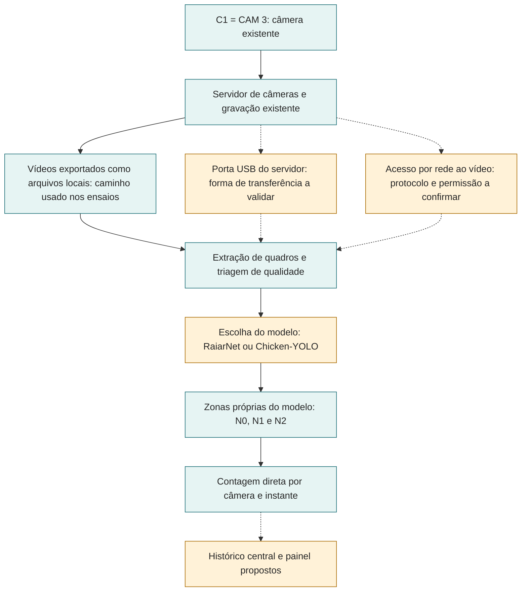

# Arquitetura preliminar de medição por nível

Esta é a arquitetura **de integração proposta**, baseada nos componentes e resultados documentados até 16 de outubro de 2026. O piloto mede aves **visíveis** em N0 (piso), N1 (meio) e N2 (plataforma), por câmera e instante. A [separação dos níveis](./visao-computacional/niveis-e-regra-de-contagem.md) tem polígonos de trabalho para C1. A aprovação física das zonas, o acesso contínuo às imagens e a execução no hardware da Raiar ainda precisam de validação.

**Figura 1: visão geral da arquitetura de medição por nível**

Fonte: elaboração da equipe (2026). Setas amarelas pontilhadas indicam acessos ou integrações ainda não validados. A faixa de registro representa o caminho implementado pelo **Chicken-YOLO**; a RaiarNet ainda não grava no mesmo histórico local. A figura não representa uma operação implantada.

**Figura 2: caminho técnico em Mermaid, editável**

Fonte: elaboração da equipe a partir da [regra de níveis](./visao-computacional/niveis-e-regra-de-contagem.md), dos [resultados da RaiarNet](./visao-computacional/contagem-por-nivel.md), do [detector Chicken-YOLO](./deteccao-de-aves.md) e dos [requisitos](../sprint-1/requisitos.md). Azul indica equipamento relatado, vídeo recebido ou código local; amarelo e setas pontilhadas indicam acesso ou integração pendente. Nenhuma cor indica homologação em campo. O fluxo executado nos ensaios começa nos arquivos de vídeo recebidos; a conexão automática com o servidor ainda não foi demonstrada. C2 é uma vista complementar proposta; sua necessidade depende da medição. As zonas precisam de versão própria para cada modelo; configuração das mesas e anotação humana orientam a calibração e a avaliação. O armazenamento local implementado pertence ao Chicken-YOLO. A seta pontilhada até o histórico não afirma que a RaiarNet já usa esse contrato.

## Conexão com as câmeras

O relato técnico de 8 de outubro informa que **as câmeras não têm entrada USB**, mas o **servidor de câmeras tem uma porta USB**. Em 14 de outubro, a equipe registrou que precisaria conectar a solução ao servidor. Isso define o ponto físico de integração, mas não demonstra que a porta USB entrega um fluxo de vídeo, nem estabelece protocolo, permissão ou método de exportação. Os ensaios de software até aqui processaram vídeos e imagens em arquivos locais, como faz `src/chicken_yolo/capture.py`.

| Trecho | Situação documentada | Próxima verificação |
| --- | --- | --- |
| C1 (CAM 3) → servidor de câmeras | Equipamentos e gravações relatados pela Raiar | Identificar câmera, canal, horário e instalação no servidor |
| Servidor → arquivos locais | Vídeos recebidos e usados nos ensaios | Reproduzir a exportação com metadados e autorização de acesso |
| Porta USB do servidor → processamento local | Porta informada, transferência não testada | Verificar se exporta arquivos, se permite leitura automatizada e como preservar horário e ID da câmera |
| Servidor → processamento por rede | Alternativa técnica em aberto | Confirmar interface, protocolo, credenciais, disponibilidade e política de acesso |

Não há USB direto entre câmera e dispositivo de processamento no desenho. A escolha entre transferência pela porta USB e acesso por rede depende de teste com o servidor real.

## Separação dos níveis

- **N0, piso:** contar diretamente as aves atribuídas ao polígono do piso. Aves pequenas e agrupadas no fundo geraram subcontagem no teste da RaiarNet.
- **N1, meio:** contar diretamente no polígono intermediário. Grade, sombra e mesa ocultam aves; não calcular N1 por diferença.
- **N2, plataforma:** contar diretamente no polígono superior. A borda distante pode ficar fora do campo útil, sobretudo à noite.
- **Fora dos polígonos:** registrar fora do escopo da C1 ou sem nível atribuível, conforme o modelo. A região azul das mesas móveis não é uma seção fechada.

A divisória verde fornece uma referência física fixa no fundo da vista; as mesas da região azul mudam com o manejo. Os polígonos da C1 são **calibração para um enquadramento e uma configuração**, não fronteiras permanentes do aviário. Mudança de câmera, recorte, resolução ou mesas exige revisar a versão das zonas antes de comparar períodos. A RaiarNet usa `src/raiarnet/configs/cameras/c1-jump-start.json`; o Chicken-YOLO tem regra e configuração próprias em `src/chicken_yolo/zones.py`. Um arquivo de zonas não deve ser aplicado ao outro sem verificar coordenadas, atribuição e versão.

Cada medição deve preservar **câmera, quadro/instante, lote quando conhecido, modelo e versão, versão de zonas, qualidade e contagem por nível**. Câmeras com campos sobrepostos não têm contagens somadas. C2 é uma vista complementar proposta; sua responsabilidade por nível depende de calibração e testes próprios. A [imagem com os três níveis](./visao-computacional/niveis-e-regra-de-contagem.md) ilustra a nomenclatura e não substitui essa calibração.

## Estado dos componentes

- **Câmeras e gravações:** vídeos C1 (CAM 3) e CAM 16 foram usados em ensaios. A conexão planejada passa pelo servidor de câmeras, cuja porta USB foi relatada; forma de transferência, protocolo, retenção, relógio, exportação e relação entre IDs ainda precisam ser confirmados.
- **RaiarNet:** `src/raiarnet/models/`, `preprocessing/roi.py` e o [teste em 7 quadros](./visao-computacional/contagem-por-nivel.md) mostram um protótipo medido em uma câmera e um dia. Ainda não há homologação em outros lotes ou na Raspberry Pi.
- **Chicken-YOLO e histórico local:** `src/chicken_yolo/` contém pipeline, zonas, SQLite e cliente de sincronização. O [piloto CAM16 com pesos pré-treinados](../sprint-1/piloto-video-raiar.md) não produziu contagem útil.
- **PIOFlow e YOLOPIO:** [experimentos com base PIO](./deteccao-e-contagem-de-galinhas.md); não demonstram conexão com as câmeras da Raiar.
- **Receptor, histórico central e painel:** os [requisitos RF07 e RF08](../sprint-1/requisitos.md) os propõem. O cliente de envio local não comprova receptor ou painel implantado.
- **Raspberry Pi 4, 4 GB:** hardware alvo dos [RNF11 e RNF12](../sprint-1/requisitos.md). Latência, CPU, memória, temperatura e operação contínua exigem ensaio real.

Os modelos são **candidatos separados**. A escolha do modelo de produção, o contrato comum de saída e o lugar do processamento são decisões futuras. O histórico local e a sincronização implementados pertencem ao Chicken-YOLO; a RaiarNet ainda não escreve nesse mesmo contrato.

## Próxima sprint: verificações em duas semanas

- **Semana 1:** selecionar poucos quadros diurnos e noturnos dos vídeos já recebidos e anotar aves visíveis em N0, N1 e N2.
- **Semana 1:** rodar o protótipo disponível nesses quadros e registrar, por nível, a contagem obtida, a contagem anotada e os casos de oclusão.
- **Semana 2:** resumir os erros em uma tabela curta e separar imagens que mostrem as dúvidas sobre N1, a borda de N2 e a possível utilidade de C2.
- **Confirmar em validação com a Raiar:** a identificação de C1 (CAM 3) e CAM 16, os limites dos níveis quando as mesas mudam e como obter vídeos pelo servidor. Levar as imagens e perguntas preparadas, sem depender de uma visita à granja durante a sprint.
- **Fechamento da sprint:** ajustar os polígonos e este diagrama somente com o que for confirmado; registrar as dúvidas restantes e o próximo teste possível com os vídeos disponíveis.

Este desenho não permite inferir o total de aves do lote, diagnosticar bem-estar ou recomendar manejo a partir da ocupação observada.
