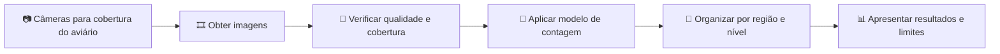

# Proposta de solução e cobertura do aviário

## 1. Problema e objetivo

A proposta busca viabilizar a contagem de aves a partir das imagens disponíveis na Raiar, considerando tanto o desempenho do modelo quanto as condições reais de captura. Para que uma contagem seja útil, precisamos conseguir acessar as imagens e enxergar as aves com detalhe suficiente nas regiões que desejamos acompanhar.

A recria e a produção acontecem em aviários distintos. Na recria, as pintainhas crescem e a disposição das aves e das estruturas muda ao longo do tempo. Em alguns momentos, elas podem estar muito próximas umas das outras ou parcialmente encobertas. Vamos avaliar a capacidade das câmeras e do modelo de distinguir e contar as aves em cada fase.

Na produção, o ambiente e a disposição das aves também precisam ser avaliados com suas próprias imagens e câmeras. Cada aviário será avaliado de acordo com suas condições de imagem e cobertura.

**Objetivo desta proposta:** definir e testar um caminho viável entre as câmeras, as imagens e o modelo de contagem, identificando onde as imagens atuais são suficientes e onde será necessário avaliar ajustes de posicionamento ou outras formas de captura.

## 2. Contexto dos aviários

### Recria

Na recria, as pintainhas crescem e passam a ocupar diferentes regiões da estrutura. A imagem abaixo ilustra a separação de níveis utilizada nos testes existentes: N0 no piso, N1 na faixa intermediária e N2 na plataforma.

<strong>Figura 1: níveis do aviário de recria nas imagens das câmeras</strong>

Fonte: elaboração da equipe a partir dos quadros das câmeras CAM 3 e CAM 16 (2026). A prévia da CAM 16 é de outra data e não representa uma captura simultânea à imagem principal.

A disposição das estruturas pode mudar durante a recria. As regiões de contagem serão ajustadas conforme o posicionamento das estruturas e o enquadramento das câmeras.

### Situações registradas na visita

Durante a visita, gravamos dois vídeos com um iPhone 15 Pro Max próximo às aves: um de cerca de 21 segundos, com pintainhas mais dispersas, e outro de cerca de 34 segundos, com uma concentração maior. Nos quadros examinados, o primeiro mostra aves separadas no piso e outras próximas à estrutura; no segundo, há forte agrupamento e sobreposição entre pintainhas.

<strong>Figura 2: pintainhas dispersas e agrupadas na visita à Raiar</strong>

| Pintainhas mais dispersas | Pintainhas mais agrupadas |
| :---: | :---: |
|  |  |
| Vídeo de 21 segundos, quadro aos 8 segundos | Vídeo de 34 segundos, quadro aos 8 segundos |

Fonte: quadros extraídos dos vídeos gravados pela equipe durante a visita à Raiar, em 28 de outubro de 2026.

Essas imagens serão usadas para avaliar uma questão central: **em quais condições conseguimos contar as pintainhas e, a partir dessa contagem, acompanhar sua distribuição entre as regiões e níveis do aviário?** A identificação dos níveis exige também que cada área esteja visível e corretamente delimitada na imagem.

As gravações foram feitas próximas às aves. Para uma câmera instalada no alto do aviário, precisamos verificar no local a distância, a altura, o enquadramento e o tamanho das pintainhas na imagem. O teste pode considerar uma distância de 3 a 5 metros entre a câmera e as pintainhas. Uma lente com campo de visão adequado ou zoom óptico pode aproximar uma região, mas é necessário comparar o detalhe obtido com a área que deixa de aparecer. Ampliar digitalmente um recorte não recupera detalhes que a câmera não capturou.

### Produção

O aviário de produção tem suas próprias estruturas, circulação de aves e câmeras. Vamos examinar as imagens da produção para definir as regiões de interesse e a forma de contagem adequada ao aviário.

### Lote e boxes

O lote ocupa o aviário, e a equipe da Raiar pode organizar esse espaço em **boxes** por meio dos portões. Com os portões abertos, o lote pode ocupar um único box, incluindo a área ao redor das estruturas ou apenas a área interna, conforme a configuração adotada. O mesmo espaço também pode ser dividido em dois ou mais boxes.

Para visualizar a proposta, consideramos a área interna das aves com cerca de **64 m × 12 m**, além de aproximadamente 2 m ao redor. Uma divisão transversal em dois boxes corresponde a cerca de **32 m × 12 m por box**. Uma divisão adicional poderia formar quatro áreas de aproximadamente **32 m × 6 m**, mas a proposta prioriza o cenário de dois boxes e o aviário completo.

### Imagens e câmeras existentes

As câmeras existentes apresentam enquadramentos e zoom que não permitem obter imagens adequadas à contagem das pintainhas. A documentação dos testes identifica a vista C1 como CAM 3 e também registra testes com a CAM 16.

A ficha fotografada na visita indica área de piso de 3.240 m² para o aviário 19. A identificação e as dimensões do espaço a monitorar serão conferidas com a planta.

## 3. Proposta de solução

### Caminho da imagem até o resultado

As câmeras atuais não cobrem uma área suficiente para contar as pintainhas e fornecer imagens adequadas ao modelo. A solução inclui definir o posicionamento e o enquadramento de câmeras que ampliem essa cobertura. O acesso às imagens e o local de processamento serão definidos nos testes de implementação.

### Posicionamento e cobertura

A análise das câmeras existentes identificou que a cobertura atual é insuficiente para a contagem das pintainhas. A proposta é posicionar câmeras adicionais para ampliar a área observada e obter imagens adequadas ao modelo.

Propomos como estimativa inicial **quatro câmeras superiores** ao longo da linha central da área das aves, voltadas para baixo e distribuídas para observar trechos consecutivos. A quantidade e o espaçamento serão confirmados pelos testes de cobertura e qualidade das imagens.

### Piloto em um box

Para testar o MVP em condições reais, propomos utilizar **um dos dois boxes**, com aproximadamente 32 m × 12 m, em vez de começar pelo aviário inteiro. Nesse trecho, a estimativa inicial é de **duas câmeras superiores**, distribuídas ao longo da linha central. Assim, podemos testar a obtenção das imagens, a cobertura e a contagem das pintainhas em uma área delimitada.

O primeiro teste continua sendo aplicar o modelo aos vídeos da visita, com pintainhas dispersas e agrupadas. Se a contagem individual funcionar, o piloto em um box permitirá verificar o fluxo com câmeras instaladas. Caso contrário, investigaremos outro método de contagem antes de expandir a solução. Para o aviário completo, mantemos a estimativa inicial de quatro câmeras; as quantidades dependem da cobertura obtida nos testes.

<strong>Figura 3: proposta de câmeras superiores na área das aves</strong>

<svg viewBox="0 0 1000 480" role="img" aria-label="Planta esquemática do aviário e da área das aves, com dois boxes e quatro câmeras superiores estimadas na linha central. As duas primeiras correspondem ao piloto em um box." width="100%" xmlns="http://www.w3.org/2000/svg">
  <rect x="60" y="65" width="880" height="350" rx="12" fill="#f4f7f8" stroke="#254e68" strokeWidth="4" />
  <text x="500" y="42" textAnchor="middle" fill="#254e68" fontSize="23" fontWeight="bold">AVIÁRIO · VISTA SUPERIOR</text>
  <text x="500" y="120" textAnchor="middle" fill="#254e68" fontSize="19">≈ 2 m ao redor da área das aves</text>
  <rect x="150" y="145" width="700" height="190" rx="5" fill="#fff1c9" stroke="#c08800" strokeWidth="3" />
  <text x="500" y="184" textAnchor="middle" fill="#664b0a" fontSize="22" fontWeight="bold">ÁREA DAS AVES</text>
  <line x1="500" y1="145" x2="500" y2="335" stroke="#c08800" strokeWidth="3" strokeDasharray="8 8" />
  <text x="325" y="215" textAnchor="middle" fill="#664b0a" fontSize="16">BOX PARA O PILOTO</text>
  <text x="675" y="215" textAnchor="middle" fill="#664b0a" fontSize="16">OUTRO BOX</text>
  <line x1="180" y1="245" x2="820" y2="245" stroke="#126c84" strokeWidth="2" strokeDasharray="8 8" />
  <circle cx="235" cy="245" r="27" fill="#126c84" /><text x="235" y="252" textAnchor="middle" fill="white" fontSize="20" fontWeight="bold">1</text>
  <circle cx="410" cy="245" r="27" fill="#126c84" /><text x="410" y="252" textAnchor="middle" fill="white" fontSize="20" fontWeight="bold">2</text>
  <circle cx="590" cy="245" r="27" fill="#126c84" /><text x="590" y="252" textAnchor="middle" fill="white" fontSize="20" fontWeight="bold">3</text>
  <circle cx="765" cy="245" r="27" fill="#126c84" /><text x="765" y="252" textAnchor="middle" fill="white" fontSize="20" fontWeight="bold">4</text>
  <text x="500" y="310" textAnchor="middle" fill="#664b0a" fontSize="18">Câmeras acima das aves, voltadas para baixo</text>
  <text x="500" y="385" textAnchor="middle" fill="#254e68" fontSize="18">1 e 2: piloto em um box · 3 e 4: expansão estimada</text>
  <text x="500" y="455" textAnchor="middle" fill="#254e68" fontSize="17">Quantidade e espaçamento sujeitos ao teste de cobertura</text>
</svg>

Fonte: elaboração da equipe com base nas informações da visita (2026). Planta esquemática, sem escala.

Como referência inicial, considerar câmeras a aproximadamente **3 a 5 metros das aves**, com lentes ajustadas para distinguir as pintainhas e observar os trechos previstos. A visão superior será avaliada também quanto à visibilidade dos níveis inferiores sob as estruturas; se houver bloqueio, uma vista complementar poderá ser necessária.

Para dimensionar a instalação, medir em uma imagem de teste o comprimento e a largura em que as pintainhas podem ser distinguidas. Dividir o comprimento a cobrir pelo comprimento útil observado e arredondar para cima; ajustar a quantidade considerando a largura, as sobreposições e os obstáculos. A planta e os testes permitirão posicionar as câmeras sobre a estrutura real.

Áreas vistas por mais de uma câmera devem ser identificadas. Uma mesma ave pode aparecer em duas imagens, por isso as contagens dessas áreas não podem ser simplesmente somadas. Primeiro será necessário definir a responsabilidade de cada vista ou testar uma forma de reconciliar as contagens.

### Modelo e contagem

Usar os modelos já desenvolvidos como ponto de partida e avaliá-los com imagens reais de cada situação. A RaiarNet já foi testada em quadros da CAM 3 com contagem por nível; o teste registrado utilizou sete quadros. Em um piloto anterior da CAM 16, o detector pré-treinado avaliado não produziu contagem útil. Esses resultados orientam a escolha das próximas imagens e configurações a testar.

Na recria, comparar imagens de pintainhas pequenas e de aves em fases posteriores, incluindo momentos de maior concentração. Quando for possível distinguir as aves, comparar a saída do modelo com a contagem manual da mesma região. Se a imagem não permitir uma referência manual confiável, registrar a limitação e testar outra vista ou enquadramento antes de atribuir o problema apenas ao modelo.

Na produção, repetir a avaliação com imagens representativas desse aviário. A contagem será apresentada por região visível e, quando fizer sentido e houver definição validada, por nível. Uma contagem de aves visíveis em uma região não representa automaticamente o total do aviário.

### Apresentação dos resultados

Para cada resultado, apresentar a câmera, a data ou o instante disponível, o aviário, a região observada, o modelo utilizado e a contagem. Indicar quando a visibilidade for parcial ou a contagem ainda não tiver sido validada. O formato da consulta ou painel será definido conforme a utilidade para a Raiar e os recursos disponíveis.
