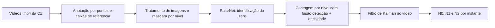

# Modelo de visão computacional construído do zero

Nesta seção, documentamos o processo ponta a ponta que seguimos para construir, do zero, o modelo que identifica as aves e as conta diretamente em cada nível do Jump Start (N0 · piso, N1 · meio e N2 · plataforma) nas imagens da câmera C1. Partimos dos vídeos `.mp4` reais recebidos da Raiar, sem nenhuma imagem anotada e sem pesos pré-treinados.

| Página | Conteúdo |
| --- | --- |
| [Níveis e regra de contagem](./niveis-e-regra-de-contagem.md) | Divisória verde fixa, região azul móvel, por que não usamos N1 = total − N0 − N2 e regra de câmeras. |
| [Dados e anotação](./dados-e-anotacao.md) | Vídeos usados, anotação assistida por pontos, caixas de referência e partição temporal. |
| [Tratamento de imagens](./tratamento-de-imagens.md) | Hipóteses ópticas, técnicas de realce, máscaras por nível e medidas sem modelo. |
| [Modelo do zero](./modelo-identificacao-do-zero.md) | Decisão de paradigma, arquitetura da RaiarNet, perdas e evolução do treino. |
| [Contagem e resultados](./contagem-por-nivel.md) | Adaptação para contagem por nível, filtragem temporal, resultados no teste e próximos passos. |

O código fica em `src/` (`labeling`, `preprocessing`, `models`, `training`, `evaluation` e `baseline`); os dados, quadros, pesos e resultados de execução ficam fora do Git. Os termos técnicos estão no [glossário](../../sprint-1/glossario.md).

Resumo dos resultados no teste: no nível intermediário (N1), parcialmente oculto, o erro médio de contagem ficou em 0,62 ave (2,9%). No total da ROI, o erro foi de 8,7%, com subcontagem concentrada no fundo do piso (N0). Na identificação, o modelo atingiu mAP@50 de 0,41 e F1 de 0,54, a 3,5 quadros por segundo em CPU. A comparação com o Chicken-YOLO é o próximo passo.
