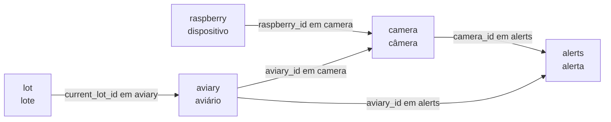

# Banco de dados: primeira versão

Esta página descreve a estrutura relacional definida para cadastrar **lotes**, **aviários**, **Raspberry Pis**, **câmeras** e **alertas**. O aviário é o espaço físico; o lote é o grupo de aves que o ocupa. Na Raiar, cada lote ocupa um aviário, mas a identificação do espaço precisa continuar estável quando o lote muda. A separação atende à distinção proposta no [dicionário de dados](../sprint-1/dicionario-de-dados.md) e ao cadastro previsto no requisito RF02 dos [requisitos](../sprint-1/requisitos.md).

O código desta versão está em `src/database/schema.sql`. O script cria todas as tabelas em um banco PostgreSQL que ainda não as contenha. A presença do arquivo no repositório não comprova que ele já foi executado em um banco em operação.

## Entidades e relacionamentos

Cada tabela tem um identificador próprio. As **chaves estrangeiras** ligam um registro ao identificador de outra tabela; por exemplo, `camera.aviary_id` aponta para `aviary.id`. A Figura 1 mostra esses vínculos. O texto sobre cada seta é o campo que guarda a referência.

**Figura 1 – Relações entre lotes, aviários, dispositivos, câmeras e alertas**



Fonte: elaborado pelos autores a partir de `src/database/schema.sql` (2026).

| Relação | Quantidade permitida | Regra no banco |
| --- | --- | --- |
| `lot` → `aviary` | Um aviário pode ter zero ou um lote atual; um lote pode ser atual em zero ou um aviário | `aviary.current_lot_id` aceita `null`, referencia `lot.id` e é único |
| `raspberry` → `camera` | Um Raspberry Pi pode ter várias câmeras; cada câmera tem exatamente um Raspberry Pi | `camera.raspberry_id` é obrigatório e referencia `raspberry.id` |
| `aviary` → `camera` | Um aviário pode ter várias câmeras; cada câmera pertence a um aviário | `camera.aviary_id` é obrigatório e referencia `aviary.id` |
| `camera` e `aviary` → `alerts` | Uma câmera e um aviário podem ter vários alertas; cada alerta indica uma câmera e um aviário | A chave estrangeira composta exige que o aviário do alerta seja o mesmo da câmera |

**Exemplo fictício:** o lote `31` ocupa atualmente o aviário `7`; a câmera `12` pertence a esse aviário e está associada ao Raspberry Pi `4`. Um alerta com `camera_id = 12` e `aviary_id = 7` respeita as relações. Se o mesmo alerta trouxer `aviary_id = 8`, o banco o rejeita, mesmo que o aviário `8` exista, porque essa não é a associação da câmera `12`.

## Campos e regras

As tabelas a seguir apresentam os nomes e tipos do PostgreSQL. **Obrigatório** significa `NOT NULL`; uma chave estrangeira só aceita valores que existam na tabela referenciada. Os campos `id` declarados como `GENERATED ALWAYS AS IDENTITY` são gerados pelo banco. Os exemplos desta página são fictícios.

### Lote (`lot`)

| Campo | Tipo | Obrigatório | Significado e regra |
| --- | --- | --- | --- |
| `id` | `integer` | Sim | Chave primária gerada automaticamente. É a referência estável do grupo de aves, inclusive quando o nome usado pela equipe mudar. |
| `name` | `character varying` | Sim | Nome ou código operacional do lote. O banco exige um valor, mas não impede que dois lotes tenham o mesmo nome; para distingui-los, usa-se `id`. |

O lote não guarda o identificador de um aviário: a associação ativa fica em `aviary.current_lot_id`. Assim, o mesmo aviário pode receber um novo lote sem trocar seu próprio `id`. O cadastro inicial do lote ainda não contém idade, data de alojamento ou quantidade de aves. Esses dados são descritos como necessários ou desejáveis no [dicionário de dados](../sprint-1/dicionario-de-dados.md), mas não fazem parte deste esquema.

### Aviário (`aviary`)

| Campo | Tipo | Obrigatório | Significado e regra |
| --- | --- | --- | --- |
| `id` | `integer` | Sim | Chave primária gerada automaticamente. Identifica o espaço físico e é o valor usado por `camera.aviary_id` e `alerts.aviary_id`. |
| `name` | `character varying` | Sim | Nome operacional do aviário, usado para reconhecê-lo em cadastros e consultas. Não precisa ser único. |
| `number` | `integer` | Sim | Número atribuído ao aviário. O banco exige seu preenchimento, mas permite números repetidos e não define faixa válida. |
| `type` | `character varying` | Sim | Classifica o aviário como `rearing` (recria) ou `normal` (aves maduras destinadas à postura). Outros valores são rejeitados pelo `CHECK`. |
| `registration_date` | `date` | Sim | Data de cadastro do aviário. Se omitida, recebe `CURRENT_DATE`; não representa a data de chegada nem a idade do lote atual. |
| `current_lot_id` | `integer` | Não | Referência a `lot.id` para o lote que ocupa o aviário agora. Pode ser `null` quando não houver lote associado; `UNIQUE` impede o mesmo lote atual em dois aviários. |

`id` identifica o local, enquanto `current_lot_id` identifica quem o ocupa neste momento. Alterar `current_lot_id` atualiza apenas essa associação atual; o esquema não registra a data dessa troca nem o lote anterior.

### Raspberry Pi (`raspberry`)

| Campo | Tipo | Obrigatório | Significado e regra |
| --- | --- | --- | --- |
| `id` | `integer` | Sim | Chave primária gerada automaticamente. As câmeras usam esse valor em `camera.raspberry_id`. |
| `name` | `character varying` | Sim | Nome amigável para a equipe identificar o dispositivo; o banco permite nomes repetidos. |
| `hostname` | `character varying` | Sim | Nome atribuído ao dispositivo na rede. A restrição `UNIQUE` impede dois cadastros com o mesmo valor. |
| `model` | `character varying` | Não | Modelo do Raspberry Pi ou outra descrição do hardware, se conhecido. Pode ficar vazio. |

`name` serve à identificação humana, enquanto `hostname` identifica o cadastro pelo nome de rede. O banco não limita quantas câmeras podem apontar para o mesmo `raspberry.id`.

### Câmera (`camera`)

| Campo | Tipo | Obrigatório | Significado e regra |
| --- | --- | --- | --- |
| `id` | `integer` | Sim | Chave primária gerada automaticamente. Os alertas usam esse valor em `alerts.camera_id`. |
| `raspberry_id` | `integer` | Sim | Chave estrangeira para `raspberry.id`; informa a qual dispositivo a câmera está associada. Um ID inexistente é rejeitado. |
| `model` | `character varying` | Não | Modelo da câmera, se conhecido. É independente de `raspberry.model` e pode ficar vazio. |
| `aviary_id` | `integer` | Sim | Chave estrangeira para `aviary.id`; indica o aviário ao qual a câmera está vinculada. Um ID inexistente é rejeitado. |

A câmera precisa ter simultaneamente um Raspberry Pi e um aviário cadastrados. A restrição `UNIQUE (id, aviary_id)` permite que o alerta referencie o par câmera–aviário e confira se ambos correspondem. O vínculo com o Raspberry Pi é um cadastro lógico; a forma de obter o vídeo pelo servidor de câmeras ainda depende das verificações descritas na [arquitetura preliminar](../sprint-2/arquitetura-preliminar.md).

### Alerta (`alerts`)

| Campo | Tipo | Obrigatório | Significado e regra |
| --- | --- | --- | --- |
| `id` | `integer` | Sim | Chave primária gerada automaticamente; distingue cada ocorrência de alerta. |
| `camera_id` | `integer` | Sim | ID da câmera de origem. É validado junto com `aviary_id` pela chave estrangeira composta. |
| `aviary_id` | `integer` | Sim | ID do aviário associado à ocorrência. Precisa existir em `aviary` e corresponder ao aviário cadastrado para a câmera. |
| `datetime` | `timestamp without time zone` | Sim | Data e hora informadas para o alerta. Quando omitidas, recebem o horário corrente do banco; o campo não guarda fuso ou deslocamento UTC. |
| `alarm_type` | `character varying` | Sim | Categoria informada para o alerta. O campo é obrigatório, mas o banco ainda não define uma lista de categorias permitidas. |

A restrição composta `alerts_camera_aviary_fkey` exige que `(camera_id, aviary_id)` corresponda a `(id, aviary_id)` na tabela `camera`. A chave estrangeira `alerts_aviary_id_fkey` também confirma que o aviário existe. O alerta guarda `aviary_id` explicitamente para identificar o local no próprio registro; o par de IDs impede que ele seja diferente do aviário da câmera. `datetime` não distingue, por si só, o horário em que a situação ocorreu do horário em que o registro foi inserido: essa convenção ainda precisa ser definida.

## Criação do esquema

O script cria `raspberry` e `lot` primeiro, depois `aviary`, `camera` e `alerts`, respeitando a ordem das chaves estrangeiras. A criação ocorre em uma transação: se algum comando falhar, nenhuma das tabelas criadas nessa execução é confirmada. O arquivo destina-se à criação inicial das tabelas e não altera registros de um esquema anterior.

Para associar um lote a um aviário, é necessário cadastrar o lote em `lot` e preencher `aviary.current_lot_id` com seu identificador. Um aviário recém-cadastrado pode ficar sem lote atual.

## Como consultar as relações

Para localizar a câmera e o aviário de um alerta, `alerts.camera_id` aponta para `camera.id` e `alerts.aviary_id` aponta para `aviary.id`. A partir do aviário, `current_lot_id` permite consultar o lote **atual**. A consulta abaixo mostra esses vínculos para um alerta específico:

```sql
SELECT
  a.id AS alert_id,
  a.datetime,
  a.alarm_type,
  c.id AS camera_id,
  r.name AS raspberry_name,
  v.id AS aviary_id,
  v.name AS aviary_name,
  l.id AS current_lot_id,
  l.name AS current_lot_name
FROM public.alerts AS a
JOIN public.camera AS c
  ON c.id = a.camera_id AND c.aviary_id = a.aviary_id
JOIN public.raspberry AS r ON r.id = c.raspberry_id
JOIN public.aviary AS v ON v.id = a.aviary_id
LEFT JOIN public.lot AS l ON l.id = v.current_lot_id
WHERE a.id = 1;
```

O `LEFT JOIN` mantém o alerta na consulta quando o aviário está sem lote atual. Se o lote do aviário tiver mudado depois do alerta, as colunas `current_lot_id` e `current_lot_name` mostrarão o **lote de hoje**, não o lote presente quando o alerta ocorreu.