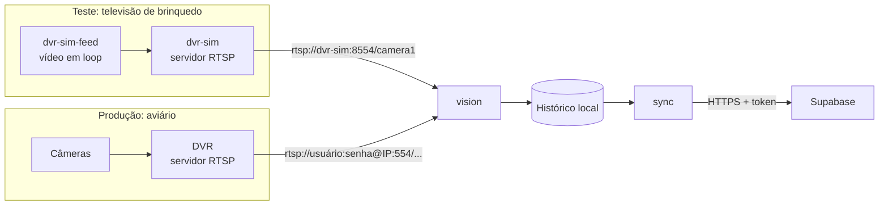

# DVR simulado e teste na prática

Esta página explica de um jeito simples o que a equipe fez para testar a captura de imagens sem ter acesso ao DVR do aviário e o que ainda precisa ser feito para testar com as câmeras de verdade. Quem quiser ver os problemas que podem aparecer e onde corrigi-los deve ler também [Falhas e do teste para a produção](./falhas-e-do-teste-para-producao.md). Os termos técnicos estão no [glossário](../sprint-1/glossario.md).

## Em linguagem simples

Imagine uma televisão com muitos canais. Cada canal mostra uma câmera diferente do aviário. Essa televisão é o **DVR**, o aparelho que recebe as câmeras e as entrega pela rede.

O Raspberry Pi é um vigia pequeno. Ele olha para um canal, tira uma "foto" a cada 5 segundos, conta quantas galinhas aparecem em cada nível e anota o resultado num caderno. De tempos em tempos, um entregador leva as anotações do caderno para o escritório, que é o banco de dados.

Para treinar o vigia antes de ele ir para o aviário, a equipe montou uma **televisão de brinquedo**: um aparelho que toca, sem parar, um vídeo gravado no "canal 1". O vigia não percebe a diferença, porque pede o vídeo do mesmo jeito que pediria ao DVR de verdade. Assim, é possível descobrir se o vigia, o caderno e o entregador funcionam sem precisar estar no aviário.

**Tabela 1 – As peças da brincadeira e do projeto**

| Peça | Na brincadeira | No projeto | Nome no `compose.yaml` |
| --- | --- | --- | --- |
| DVR | A televisão com muitos canais | O gravador do aviário, que entrega cada câmera por uma URL **RTSP** | (não está no repositório) |
| DVR simulado | A televisão de brinquedo | Um servidor RTSP de teste (MediaMTX) | `dvr-sim` |
| Alimentador | A fita de vídeo tocando em loop | O `ffmpeg`, que repete um vídeo do repositório sem recodificá-lo | `dvr-sim-feed` |
| Vigia | O vigia que olha um canal | O programa `raiar-vision run`, que lê as câmeras e conta as aves | `vision` |
| Caderno | O caderno de anotações | O histórico local (SQLite), que sobrevive a quedas de rede | pasta `RAIAR_DATA` |
| Entregador | Quem leva o caderno ao escritório | O `raiar-vision sync`, que envia os resultados a cada 5 minutos | `sync` |
| Escritório | A sala onde as anotações ficam guardadas | O banco no Supabase | (nuvem) |

Fonte: elaborado pelos autores (2026).

**Figura 1 – O teste e o uso real percorrem o mesmo caminho a partir do vigia**



Fonte: elaborado pelos autores (2026).

## O que a simulação provou e o que não provou

A simulação respondeu a perguntas sobre o nosso código. Ela não respondeu a perguntas sobre o equipamento do aviário.

**Tabela 2 – Alcance da simulação**

| Pergunta | Resposta | Como foi verificado |
| --- | --- | --- |
| O programa lê uma câmera por RTSP e grava uma análise a cada 5 s? | Sim | Execução no notebook com o `dvr-sim` |
| O que acontece se o DVR cair e voltar? | O `vision` avisa a queda, não grava análises repetidas e volta sozinho | Parada do `dvr-sim` por 25 s |
| Várias câmeras ao mesmo tempo funcionam? | Sim, no notebook, com 3 câmeras: duas boas e uma com URL errada | Execução com um `cameras.yaml` de 3 câmeras |
| Uma câmera com URL errada atrapalha as outras? | Não: as outras seguiram gravando, e a errada gerou uma mensagem por tentativa | Mesma execução |
| A senha da URL vai parar no histórico ou nos avisos? | Não: a URL é gravada sem usuário e senha | Busca da senha no histórico, que não a encontrou |
| O envio ao banco evita duplicatas? | Sim | Reenvio das mesmas análises |
| O DVR da Raiar funciona com o projeto? | **Não sabemos** | Não foi testado |
| O Raspberry Pi aguenta o captador contínuo? | **Não sabemos** | A execução foi no notebook, não no nó |
| O modelo conta bem as aves nos níveis? | **Não sabemos** | O vídeo de teste não tem zonas calibradas e o modelo `coco` não detectou aves nele |

Fonte: elaborado pelos autores (2026), a partir das execuções de 3 de novembro de 2026.

## Como repetir a simulação

Estes passos servem para qualquer pessoa que baixar o projeto. Eles exigem Docker com Compose e um terminal na raiz do repositório.

1. Copie o arquivo de exemplo e edite o `.env`:

   ```bash
   cp .env.exemplo .env
   ```

   Para a simulação, `RAIAR_CAMERA_SOURCE` deve ser `rtsp://dvr-sim:8554/camera1`. O `RAIAR_SYNC_URL` e o `RAIAR_SYNC_TOKEN` são obrigatórios mesmo no teste; se você não tem banco, deixe os valores de exemplo, e o `sync` apenas vai falhar e guardar tudo como pendente.

2. Construa a imagem e suba o DVR simulado, o `vision` e o `sync`:

   ```bash
   docker compose --env-file .env --profile captura --profile simulacao up -d --build
   ```

3. Acompanhe o vigia. A cada cerca de 5 segundos deve aparecer uma linha como esta:

   ```bash
   docker compose --profile captura --profile simulacao logs -f vision
   ```

   ```text
   camera=1 status=valido aves=0 niveis={}
   ```

   O modelo `coco` não é bom para contar galinhas, então `aves=0` é normal. Vale olhar o `status=valido`, que mostra que o caminho dos dados funciona. Os `niveis={}` vazios aparecem porque o teste não tem zonas calibradas.

4. Para ver o vigia lidar com uma queda, pare o DVR de brinquedo, espere meio minuto e ligue-o de novo:

   ```bash
   docker compose --profile simulacao stop dvr-sim
   docker compose --profile simulacao start dvr-sim
   ```

   Nos logs aparecem `camera=1 queda: tentativa N: ...` enquanto ele está parado e `camera=1 recuperada: voltou a entregar quadros` depois.

5. Para encerrar e apagar o que o teste criou:

   ```bash
   docker compose --profile captura --profile simulacao down -v
   ```

   Os dados do histórico ficam na pasta `RAIAR_DATA` (por padrão, `/opt/raiar/data`) e não são apagados por esse comando.

## Como testar na prática com o DVR de verdade

A diferença entre o teste e o aviário está em um único endereço: no lugar da URL do `dvr-sim`, o vigia recebe a URL de um canal do DVR real. Todo o resto depende de conseguir essa URL e de ela funcionar.

1. **Perguntar à Raiar** a marca e o modelo do DVR, se o RTSP está habilitado, o IP (de preferência fixo), um usuário só com permissão de leitura, quantos canais existem e qual canal corresponde a cada ponto do aviário. Peça também o *substream*, o segundo fluxo de menor resolução, em H.264, porque decodificar H.265 no Raspberry Pi pesa no orçamento de CPU.
2. **Descobrir a URL do canal.** O formato muda conforme a marca. Os exemplos abaixo são comuns, mas precisam ser confirmados no manual do DVR:

   ```text
   rtsp://USUARIO:SENHA@IP_DO_DVR:554/cam/realmonitor?channel=1&subtype=1
   rtsp://USUARIO:SENHA@IP_DO_DVR:554/Streaming/Channels/102
   ```

3. **Testar a URL antes de usar o projeto.** No Raspberry Pi, o comando abaixo pergunta ao DVR qual vídeo ele entrega, sem rodar nenhum modelo. Se a resposta for algo como `h264,1280,720`, a URL está certa. Se travar ou der erro, o problema é da URL, do usuário, da senha, da rede ou do DVR, e não do projeto:

   ```bash
   docker run --rm --network host --entrypoint ffprobe raiar/vision:0.1.0 \
     -rtsp_transport tcp -v error -show_entries stream=codec_name,width,height \
     -of csv=p=0 "rtsp://USUARIO:SENHA@IP_DO_DVR:554/CAMINHO"
   ```

4. **Começar com um canal.** Coloque a URL em `RAIAR_CAMERA_SOURCE` no `.env`, deixe `RAIAR_CAMERA_ID` com o número da câmera cadastrada no banco e suba **sem** o perfil de simulação:

   ```bash
   docker compose --env-file .env --profile captura up -d
   ```

5. **Conferir os três pontos de passagem.** Primeiro, as linhas `camera=... status=valido` nos logs do `vision`. Depois, o `sync` sem recusas. Por fim, as linhas na tabela `analysis` do banco. Se algum deles falhar, o [mapa de falhas](./falhas-e-do-teste-para-producao.md#mapa-de-falhas) diz onde olhar.
6. **Só depois, acrescentar mais canais** (próxima seção) e deixar rodar por 24 horas para medir CPU, memória e temperatura, como pedem o RNF11 e o RNF12.

## Escolher quais câmeras o Raspberry Pi usa

A lista de câmeras que o vigia observa fica em um arquivo, `config/cameras.yaml`, dentro da pasta `RAIAR_CONFIG` do Raspberry Pi (por padrão, `/opt/raiar/config`). Se esse arquivo existir, ele vale no lugar de `RAIAR_CAMERA_SOURCE`.

```yaml
cameras:
  - id: 1
    source: rtsp://USUARIO:SENHA@IP_DO_DVR:554/CAMINHO_DO_CANAL_1
    interval_seconds: 5
    zones: config/zonas-camera-1.yaml
  - id: 2
    source: rtsp://USUARIO:SENHA@IP_DO_DVR:554/CAMINHO_DO_CANAL_2
    enabled: false
```

**Tabela 3 – Campos de cada câmera**

| Campo | Obrigatório | Significado |
| --- | --- | --- |
| `id` | Sim | O `camera.id` cadastrado no banco, um número. É por ele que o banco descobre o aviário |
| `source` | Sim | A URL RTSP, `/dev/video0` (USB) ou o caminho de um arquivo de vídeo |
| `interval_seconds` | Não | Segundos entre quadros. O padrão e o mínimo são 5 |
| `enabled` | Não | `false` desliga a câmera sem apagá-la da lista. O padrão é `true` |
| `zones` | Não | Arquivo de zonas **desta** câmera. Sem ele, a câmera é analisada sem níveis |
| `lote_id` | Não | Informativo. O banco usa o lote atual do aviário, e não este valor |

Fonte: elaborado pelos autores (2026), a partir de `src/chicken_yolo/live.py`.

Para trocar a seleção, edite o arquivo e reinicie o vigia, porque a lista só é lida na partida:

```bash
docker compose --profile captura restart vision
```

Cada câmera precisa do seu próprio arquivo de zonas, pois as zonas são calibradas para um enquadramento. Dentro do arquivo, `camera_id` deve ser igual ao `id` da câmera no `cameras.yaml`, e `calibrated: true` precisa estar presente. Sem isso, as análises saem como `imagem_inadequada`.

Três limites desta etapa:

- **Não existe tela para escolher as câmeras.** Hoje a escolha é feita editando o arquivo. Nada no banco ou no front controla essa lista ainda.
- **O Raspberry Pi processa uma câmera por vez.** A inferência levou cerca de 2,7 s por quadro (percentil 95, modelo `coco`, imagem de 640 px, medida no nó). Com N câmeras, cada uma é atendida em intervalos de aproximadamente N × 2,7 s, ou seja, de 5 s só até duas câmeras. Com mais câmeras, aumente o `interval_seconds` ou espere a medição do nó com as câmeras reais.
- **Cada câmera ligada decodifica vídeo o tempo todo.** O custo disso no Raspberry Pi ainda não foi medido.
