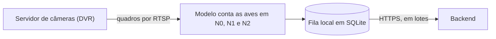

# Integração dos containers de visão computacional no nó de borda

Esta página propõe como os containers dos modelos devem funcionar no nó de borda descrito em [Nó de borda no Raspberry Pi](./provisionamento-raspberry-pi.md). Ela serve de combinado entre quem prepara o sistema e quem containeriza os modelos. Os termos técnicos estão no [glossário](../sprint-1/glossario.md), e quem nunca usou Docker encontra os conceitos e os exercícios no [Guia de Docker para iniciantes](./exemplo-containers/guia-docker-para-iniciantes.md).

## Em linguagem simples

O nó de borda é um pequeno computador instalado no aviário. Ele recebe as imagens das câmeras, usa um programa de visão computacional para contar as aves em cada nível do Jump Start e envia o resultado a um sistema central pela internet. Se a internet cair, o nó continua trabalhando e guarda os resultados num arquivo local, para enviá-los quando a conexão voltar.

Para que o programa funcione igual em todos os nós, ele é empacotado num **container**. Um container é como uma marmita fechada: leva dentro o programa e tudo o que ele precisa, e funciona do mesmo jeito em qualquer computador que tenha Docker, a ferramenta que abre essas marmitas. Cada versão do pacote recebe uma etiqueta (*tag*), e voltar a uma versão anterior é só escolher a etiqueta antiga.

A versão do Compose e dos Dockerfiles que a equipe usará no nó é a da containerização, mantida no repositório pelo responsável por ela e ainda em revisão. Os arquivos citados nesta página, em `src/edge/exemplos-docker/`, são o exemplo de referência do combinado.

## Papel do nó e fluxo de dados

O nó só executa containers que leem as câmeras, contam as aves em cada nível e enviam o resultado ao backend (o sistema central). Ele não guarda interface, treino nem dados históricos de longo prazo. O fluxo tem quatro etapas, e cada uma atende a um requisito já definido na [página de requisitos](../sprint-1/requisitos.md).

**Figura 1 – Fluxo de dados do nó de borda**



Fonte: elaborado pelos autores (2026), a partir dos requisitos RF04 a RF06 e RNF01. Mostra o caminho principal; as alternativas à captura pelo DVR estão na seção correspondente.

| Etapa | O que acontece | Requisito |
| --- | --- | --- |
| Captura | O nó lê quadros periódicos do servidor de câmeras (DVR) por RTSP, o protocolo que entrega o vídeo pela rede. Alternativas: arquivos exportados pelo servidor ou câmera USB própria | RF04 |
| Inferência | O modelo conta as aves em N0, N1 e N2 em cada quadro | RF05, RF06 |
| Fila local | O resultado é gravado em SQLite, um banco de dados guardado em um único arquivo, no próprio nó, mesmo sem rede | RNF01, RNF10 |
| Sincronização | Lotes de resultados vão ao backend por HTTPS, a conexão protegida da internet, sem duplicar registros | RNF04 |

A fila local é a peça que torna o nó tolerante a falhas. O detector grava cada análise em `outputs/results.sqlite3` com uma chave única, o `analise_id`, e o comando `raiar-vision sync` só retira da fila os identificadores que o servidor confirma, como descrito em [Detecção de aves com YOLO](../sprint-2/deteccao-de-aves.md). Assim, o nó pode ficar 24 horas sem rede e enviar tudo depois, uma única vez.

## Orçamento de recursos

O orçamento de recursos é a conta de quanto o equipamento tem e de quanto sobra para os modelos. O nó foi medido reiniciado, com o Docker ativo e nenhum container de modelo.

| Recurso | Total | Em uso no nó | Disponível |
| --- | --- | --- | --- |
| RAM, a memória de trabalho | 3.815 MB | 244 MB, dos quais cerca de 124 MB são `dockerd` e `containerd` | 3.571 MB |
| Cartão SD (raiz) | Conforme o cartão em uso (`df -h /`) | 1,1 GB | Total menos 1,1 GB |
| Swap comprimido (`zram`) | 1,9 GB | 0 | 1,9 GB |

O espaço do cartão SD é o que define quanto sobra para as imagens dos containers, que precisam caber com folga no espaço livre.

Também foi medido o pico de memória do detector ao processar um quadro de 640 x 480 pixels, em `x86_64`.

| Modelo | Pico de memória | Observação |
| --- | --- | --- |
| YOLO11n (`coco`) | cerca de 309 MB | Roda com limite de 384 MB; é encerrado com 256 MB |
| YOLO11m (`poultryvision`) | cerca de 509 MB | Roda com limite de 512 MB, sem folga |

Esses valores não incluem a captura ao vivo e podem ser diferentes em `arm64`, então servem só de ordem de grandeza. O RNF12 exige que a memória disponível fique em pelo menos 20% da RAM reconhecida, o que equivale a cerca de 763 MB. Descontada essa reserva, os containers podem somar aproximadamente **2,8 GB de RAM**. O mesmo requisito limita a CPU a 80% da capacidade, em média, em janelas de cinco minutos.

## Arquitetura proposta

A proposta usa uma única imagem do projeto, executada por dois serviços do Docker Compose, a ferramenta que descreve vários containers em um só arquivo [1].

| Serviço | Função | Limite de memória inicial |
| --- | --- | --- |
| `vision` | Lê as câmeras, executa o modelo e grava no SQLite | 2 GB |
| `sync` | Executa `raiar-vision sync` em laço, a cada poucos minutos | 128 MB |

Os dois serviços compartilham a pasta `/opt/raiar/data`, onde fica o SQLite. A divisão em dois serviços tem os motivos abaixo.

- Apenas um processo deve abrir cada fonte de imagem por vez, e o modelo só deve existir uma vez na memória. Por isso captura e inferência ficam juntas no `vision`.
- O `sync` usa apenas bibliotecas leves (`json`, `sqlite3` e `requests`), e o `ultralytics` e o OpenCV são importados só dentro das funções que os usam. Assim, o `sync` roda da mesma imagem sem carregar o PyTorch na memória.
- Falhas de rede não podem derrubar a inferência. Em serviços separados, o `sync` pode falhar e reiniciar sem tocar na captura.
- O detector abre o SQLite no modo WAL, que permite ler enquanto outro processo escreve, o que cobre este uso [2].

## Decisões e alternativas

| Decisão | Alternativa descartada | Motivo |
| --- | --- | --- |
| Docker com Compose | Podman sem *daemon* (processo residente) | A equipe já containeriza com Docker, e o custo fixo de cerca de 124 MB cabe no orçamento |
| Containers | Rodar direto no sistema, com ambiente virtual Python | Containers dão imagens versionadas, reversíveis e iguais em todos os nós |
| Uma imagem, dois serviços | Duas imagens | Um único *build* (construção da imagem) e um único conjunto de dependências a manter |
| Build no notebook, para `arm64` | Build no Raspberry Pi | O nó tem pouca RAM e disco, e compilar nele competiria com os modelos |
| Quadros em memória (`tmpfs`) | Quadros no cartão SD | Gravar uma imagem a cada intervalo desgasta o cartão; só resultados e imagens representativas vão para o disco |
| Resultado local primeiro | Envio direto ao backend | Sem uma fila durável, um corte de rede perderia resultados |
| Sem Kubernetes | k3s ou similares | O custo de memória do orquestrador seria alto para três nós de 4 GB |

## Imagem do container

O ponto de partida é uma imagem Python enxuta. O Dockerfile abaixo, em `src/edge/exemplos-docker/02-raiar-vision/`, **foi construído e executado no notebook**, com o modelo `coco`. Um Dockerfile é a receita da imagem, com um passo por linha.

```dockerfile
FROM python:3.12-slim

RUN apt-get update \
 && apt-get install -y --no-install-recommends libgl1 libglib2.0-0 \
 && rm -rf /var/lib/apt/lists/*

RUN pip install --no-cache-dir torch==2.14.1 torchvision==0.29.1 \
      --index-url https://download.pytorch.org/whl/cpu

WORKDIR /app
COPY pyproject.toml README.md ./
COPY src/chicken_yolo ./src/chicken_yolo
RUN pip install --no-cache-dir .

ARG MODELO=coco
RUN raiar-vision prepare-model ${MODELO}

RUN useradd --uid 1000 --create-home raiar \
 && mkdir -p /app/outputs && chown raiar:raiar /app/outputs
USER raiar
ENV YOLO_CONFIG_DIR=/tmp/ultralytics

ENTRYPOINT ["raiar-vision"]
CMD ["--help"]
```

Quatro escolhas desse arquivo vieram de problemas encontrados nos testes.

| Escolha | Problema que evita |
| --- | --- |
| PyTorch só para CPU, de um índice exclusivo [3] | O Raspberry Pi não tem placa de vídeo NVIDIA. O `uv.lock` marca as bibliotecas CUDA (a tecnologia de placas NVIDIA) apenas como `linux`, sem restringir a `x86_64`, e um `uv sync --frozen` em `arm64` baixaria cerca de 2,7 GB delas. Misturar o índice da CPU com o PyPI como índice extra também pode trazer a versão CUDA, porque o `uv` dá prioridade ao índice extra, e foi o que produziu, na containerização, uma imagem de 6,79 GB |
| Programa chamado `raiar-vision` | Com o nome `chicken-yolo`, que termina em `yolo`, o Ultralytics se supõe na própria linha de comando e o `predict` devolve `None`. A falha é registrada como `falha_processamento` com o motivo `'NoneType' object is not subscriptable` |
| Pesos baixados na construção | O nó não depende da internet para iniciar, e o `prepare-model` grava em `src/chicken_yolo/models/pretrained`, que o usuário comum não consegue escrever |
| Pastas de trabalho em local gravável | Com o sistema de arquivos somente leitura, o programa falha ao tentar criar `/app/.cache`. As pastas de cache devem apontar para uma área gravável, como `tmpfs` ou um volume |

Para verificar que a imagem não carrega CUDA, a validação deve conferir que `torch.version.cuda` vale `None` e que não existe a pasta `site-packages/nvidia`.

O exemplo desta página ficou com cerca de 2,5 GB em `x86_64`, dos quais 1 GB é o PyTorch para CPU. O tamanho continua sendo o maior risco de armazenamento, e a proposta é reduzi-lo em fases, sempre medindo antes de avançar.

| Fase | O que fazer | Como decidir |
| --- | --- | --- |
| 1 | Containerizar o código atual, com pesos pré-treinados e PyTorch para CPU | Medir tamanho da imagem em `arm64`, RAM em `docker stats` e tempo por quadro |
| 2 | Exportar o modelo para ONNX ou NCNN (formatos mais leves) com `raiar-vision export` e repetir o `benchmark` no nó | Escolher o formato que cumpre o RNF11, com a inferência em até 80% do intervalo entre quadros [4] |
| 3 | Trocar o PyTorch por um *runtime* de inferência menor, como o ONNX Runtime [5] | Só se a fase 1 não couber no orçamento; exige mudar o código do detector |

O `opencv-python` precisa das bibliotecas `libgl1` e `libglib2.0-0`, que arrastam componentes gráficos inúteis num nó sem tela. A versão `opencv-python-headless`, sem interface gráfica, as dispensa e reduz a imagem.

## Composição dos serviços

O arquivo abaixo, em `src/edge/exemplos-docker/02-raiar-vision/compose.yaml`, descreve os dois serviços. O `sync` foi executado no notebook contra um servidor de testes, enviou a análise e usou cerca de 1 MB de memória enquanto esperava. O `vision` ainda depende da captura ao vivo, que não existe no código, e por isso não deve subir por padrão: sem captura, ele falharia e seria reiniciado sem parar, gastando CPU e escrevendo logs no cartão. Os valores de memória e CPU precisam ser confirmados no nó com o modelo carregado [6].

```yaml
name: raiar-edge

x-comum: &comum
  image: raiar-vision:${RAIAR_TAG:-dev}
  restart: unless-stopped
  user: "1000:1000"
  read_only: true
  cap_drop: [ALL]
  security_opt: ["no-new-privileges:true"]
  environment:
    YOLO_CONFIG_DIR: /tmp/ultralytics
    RAIAR_SYNC_TOKEN: ${RAIAR_SYNC_TOKEN:-}
  volumes:
    - ${RAIAR_DATA:-/opt/raiar/data}:/app/outputs
  tmpfs:
    - /tmp:size=64m

services:
  vision:
    <<: *comum
    # Laço de captura e inferência ao vivo: ainda não existe no código (a implementar).
    # Fonte padrão: DVR por RTSP. Para câmera USB, some o compose.usb.yaml (veja abaixo).
    environment:
      YOLO_CONFIG_DIR: /tmp/ultralytics
      RAIAR_CAMERA_SOURCE: ${RAIAR_CAMERA_SOURCE:?defina RAIAR_CAMERA_SOURCE}
      RAIAR_CAMERA_ID: ${RAIAR_CAMERA_ID:-camera-1}
      OPENCV_FFMPEG_CAPTURE_OPTIONS: "rtsp_transport;tcp"
    mem_limit: 2g
    cpus: 3.2
    tmpfs:
      - /tmp:size=64m
      - /frames:size=128m

  sync:
    <<: *comum
    entrypoint:
      - sh
      - -c
      - |
        while true; do
          raiar-vision sync --database /app/outputs/results.sqlite3 \
            --url "$$RAIAR_SYNC_URL" --token-env RAIAR_SYNC_TOKEN --batch-size 100 || true
          sleep 300
        done
    environment:
      YOLO_CONFIG_DIR: /tmp/ultralytics
      RAIAR_SYNC_TOKEN: ${RAIAR_SYNC_TOKEN:-}
      RAIAR_SYNC_URL: ${RAIAR_SYNC_URL:?defina RAIAR_SYNC_URL}
    mem_limit: 128m
    cpus: 0.5
```

Seis pontos desse arquivo merecem explicação.

- O container roda com o usuário `1000:1000`, que é o `raiar` do nó, sem capacidades extras e sem novos privilégios [7]. Em termos simples, o programa roda sem poderes de administrador, para que uma falha nele não comprometa o nó. A pasta de dados precisa pertencer ao usuário 1000, ou o container recebe `Permission denied` (permissão negada).
- O sistema de arquivos é somente leitura, com `/tmp` e `/frames` em memória, o que protege o cartão SD. A variável `YOLO_CONFIG_DIR` leva a configuração do `ultralytics` para `/tmp`, porque ele tenta gravar no diretório pessoal.
- A URL e o token do backend ficam em um arquivo `.env`, com permissão `600` (só o dono lê), nas variáveis `RAIAR_SYNC_URL` e `RAIAR_SYNC_TOKEN`. O token é uma senha de acesso ao backend. Nenhuma credencial entra na imagem nem no repositório. O `sync` aceita apenas HTTPS, ou HTTP em `localhost` para testes.
- A fonte das imagens vem de uma única variável, `RAIAR_CAMERA_SOURCE`. Com o DVR, ela recebe a URL `rtsp://usuario:senha@IP_DO_DVR:554/...`, que contém a senha e por isso fica só no `.env`, e não na linha de comando do container, onde outros programas poderiam lê-la. O transporte `tcp` evita perda de pacotes em rede instável. Cada canal do DVR é uma câmera, com seu `RAIAR_CAMERA_ID`. O ideal é pedir ao DVR o *substream* (um segundo fluxo, de menor resolução) em H.264, porque decodificar H.265 em CPU pesa no orçamento do RNF12.
- `cpus: 3.2` é 80% dos quatro núcleos e funciona como teto. O RNF12 trata da média em janelas de cinco minutos, então o teto não substitui a medição.
- O `restart: unless-stopped` reinicia o container depois de uma falha ou de uma queda de energia, e só não o reinicia se alguém o parar de propósito.

### Alternativas se o DVR não puder ser usado

A [arquitetura preliminar](../sprint-2/arquitetura-preliminar.md) registra que as câmeras da Raiar não têm USB e que o servidor de câmeras tem uma porta USB, sem demonstrar que ela entrega vídeo. Por isso, o plano alternativo tem duas formas, e nenhuma delas exige mudar a imagem.

**Arquivos exportados pelo servidor.** Se o servidor só exportar gravações pela porta USB, o nó processa pastas de vídeos com `raiar-vision predict --source PASTA`, que o código já suporta. Perde-se a captura contínua: o processamento passa a ser em lotes e depende de alguém levar os arquivos ao nó, o que enfraquece o RF04 e o RNF01. Os arquivos precisam preservar horário e identificação da câmera.

**Câmera USB própria.** Se a Raiar aceitar instalar uma câmera nova, a mudança é só de configuração. Basta definir `RAIAR_CAMERA_SOURCE=/dev/video0` no `.env`, gravar o número do grupo `video` com `echo "VIDEO_GID=$(getent group video | cut -d: -f3)" >> /opt/raiar/.env` e subir com um segundo arquivo que libera o dispositivo da câmera ao container por `devices`, e não por `privileged`, que daria poderes demais:

```yaml
# compose.usb.yaml
services:
  vision:
    devices: ["/dev/video0:/dev/video0"]
    group_add: ["${VIDEO_GID:-983}"]
```

```bash
RAIAR_TAG=TAG docker compose -f compose.yaml -f compose.usb.yaml up -d
```

O restante (imagem, SQLite, `sync`, limites) é idêntico. O código de captura deve aceitar as três formas de fonte: uma URL que começa com `rtsp://`, um caminho `/dev/videoN` e uma pasta de arquivos. Se a Raiar validar o DVR, o `compose.usb.yaml` não é usado.

Os motivos para abandonar o DVR são: RTSP desabilitado ou protegido sem credencial disponível; servidor em rede que o nó não alcança; só haver H.265 em alta resolução, que pesa na CPU; ou limite de conexões simultâneas do servidor.

## Entrega e atualização

Cada versão é uma imagem com *tag* única, como o hash curto do commit (um código que identifica a versão do código). Com isso, voltar atrás é trocar a *tag*.

1. No notebook, uma única vez, instalar `qemu-user-static` e `qemu-user-static-binfmt`, que permitem emular `arm64`.
2. Construir a imagem com `docker buildx build --platform linux/arm64 -t raiar-vision:TAG --load .` [8].
3. Enviar ao nó por `docker save raiar-vision:TAG | gzip | ssh raiar@IP_DO_NO 'gunzip | docker load'`. Se a equipe adotar um registro de imagens, este passo vira `docker pull`.
4. No nó, atualizar com `RAIAR_TAG=TAG docker compose up -d` e observar `docker compose logs`.
5. Se algo falhar, repetir o passo 4 com a *tag* anterior.

O envio por SSH exige uma senha ou chave para o usuário `raiar`, que ainda deve ser definida com `passwd raiar` e `ssh-copy-id`.

## O que é preciso do nó e dos containers

Este é o combinado mínimo entre as duas frentes.

| Item | Valor combinado |
| --- | --- |
| Arquitetura da imagem | `linux/arm64` |
| Tamanho da imagem | Sem CUDA (`torch.version.cuda` igual a `None`) e dentro do espaço livre do cartão |
| Usuário no nó | `raiar` (uid 1000), nos grupos `docker` e `video` |
| Câmera | DVR por RTSP (principal), em `RAIAR_CAMERA_SOURCE`; `/dev/video0` por `compose.usb.yaml` (alternativa) |
| Dados persistentes | `/opt/raiar/data` no cartão SD, montado em `/app/outputs` |
| Segredos | `/opt/raiar/.env`, permissão `600` |
| Comandos usados | `raiar-vision predict`, `raiar-vision sync` (nunca `chicken-yolo`) |
| Rede | Saída HTTPS ao backend e acesso ao DVR na rede local (RTSP, porta 554); nenhuma porta publicada pelos containers |
| Reinício | `restart: unless-stopped`, com o Docker habilitado no boot |

O nó entrega Docker, Compose, `zram` e as ferramentas de câmera USB. A containerização entrega a imagem, o `compose.yaml` e um `.env` de exemplo, sem credenciais.

## Pontos que ainda dependem de código ou de hardware

A captura ao vivo ainda não existe: hoje o `chicken_yolo` lê arquivos locais, e a integração com a câmera está prevista na documentação do detector. O serviço `vision` depende dessa captura e do laço periódico, que também deve registrar um sinal de funcionamento para um futuro `healthcheck`, uma verificação automática de que o serviço continua vivo.

O DVR é um ponto de falha novo: se ele cair, o stream cair ou a rede local falhar, o laço deve registrar o erro (data, hora, dispositivo e tipo, conforme o RNF10) e tentar de novo com espera crescente (*backoff*), sem encerrar o container. A internet instável afeta apenas o `sync`, porque o DVR fica na rede local e o SQLite guarda os resultados enquanto não há conexão. O cabo Ethernet é preferível ao Wi-Fi nos dois trechos.

O Raspberry Pi não tem relógio de hardware. Depois de um reinício sem rede, o horário só se corrige quando a conexão volta, e um horário errado compromete a série temporal. A sugestão é um módulo de relógio externo (RTC) no case e, no software, iniciar o Docker somente depois da sincronização de horário.

## Validação antes de homologar

| Teste | Critério | Requisito |
| --- | --- | --- |
| Imagem sem CUDA | `torch.version.cuda` igual a `None` e tamanho compatível com o espaço livre do cartão | RNF12 |
| Execução como no Compose | A imagem inicia com o sistema de arquivos somente leitura, usuário 1000 e `tmpfs`, sem erro de gravação | RNF10 |
| Fonte de imagem acessível | O nó alcança o servidor de câmeras (`nc -zv IP_DO_DVR 554`) e o container lê um quadro da URL RTSP; na alternativa USB, `v4l2-ctl --list-devices` lista a câmera e o container abre `/dev/video0` | RF04 |
| Consumo de recursos | `docker stats` com o modelo carregado cabe nos limites propostos | RNF12 |
| Tempo por quadro | Inferência em até 80% do intervalo em pelo menos 95% dos quadros | RNF11 |
| Operação contínua | 24 horas com CPU média de até 80% e memória disponível de pelo menos 20% | RNF12 |
| Sem rede | 24 horas sem conexão e envio único dos registros ao voltar | RNF01, RNF04 |
| Queda de energia | Após desligar e ligar, o Docker e os containers voltam sozinhos | RNF01 |
| Falhas registradas | DVR fora do ar, câmera desconectada ou rede fora gera registro, sem perda silenciosa | RNF10 |
| Troca de fonte | Trocar `RAIAR_CAMERA_SOURCE` entre RTSP, USB e pasta funciona sem reconstruir a imagem | RF04 |

## Referências {#referencias}

[1] DOCKER INC. **Compose file reference**. Disponível em: [https://docs.docker.com/reference/compose-file/](https://docs.docker.com/reference/compose-file/). Acesso em: 26 out. 2026.

[2] SQLITE. **Write-ahead logging**. Disponível em: [https://sqlite.org/wal.html](https://sqlite.org/wal.html). Acesso em: 26 out. 2026.

[3] PYTORCH FOUNDATION. **Get started locally**. Disponível em: [https://pytorch.org/get-started/locally/](https://pytorch.org/get-started/locally/). Acesso em: 26 out. 2026.

[4] ULTRALYTICS. **Raspberry Pi setup and benchmarks**. Disponível em: [https://docs.ultralytics.com/guides/raspberry-pi/](https://docs.ultralytics.com/guides/raspberry-pi/). Acesso em: 26 out. 2026.

[5] ONNX RUNTIME. **ONNX Runtime documentation**. Disponível em: [https://onnxruntime.ai/docs/](https://onnxruntime.ai/docs/). Acesso em: 26 out. 2026.

[6] DOCKER INC. **Resource constraints**. Disponível em: [https://docs.docker.com/engine/containers/resource_constraints/](https://docs.docker.com/engine/containers/resource_constraints/). Acesso em: 26 out. 2026.

[7] DOCKER INC. **Docker security**. Disponível em: [https://docs.docker.com/engine/security/](https://docs.docker.com/engine/security/). Acesso em: 26 out. 2026.

[8] DOCKER INC. **Multi-platform builds**. Disponível em: [https://docs.docker.com/build/building/multi-platform/](https://docs.docker.com/build/building/multi-platform/). Acesso em: 26 out. 2026.
