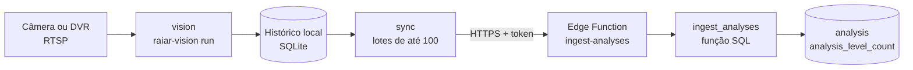

# Integração do nó de borda com o banco de dados

Esta página descreve o caminho que uma análise percorre desde o quadro capturado no Raspberry Pi até uma linha no banco de dados, e o que foi acrescentado ao esquema inicial do banco (`src/database/schema.sql`, descrito em [Banco de dados: primeira versão](./banco-de-dados.md)) para recebê-la. O nó guarda cada análise primeiro em um histórico local e só depois a envia, de modo que uma queda de rede não perde resultados, como pede o RNF04. Os termos técnicos estão no [glossário](../sprint-1/glossario.md).

## Caminho dos dados

**Figura 1 – Do quadro da câmera ao registro no banco**



Fonte: elaborado pelos autores (2026).

O `vision` captura um quadro por câmera a cada intervalo e grava a análise no histórico local. O `sync` consulta o histórico a cada cinco minutos, envia as análises ainda não confirmadas e só marca como entregues os identificadores que o servidor devolve em `accepted_analysis_ids`. A Edge Function confere o token e entrega o lote à função SQL `ingest_analyses`, que grava as análises e informa quais aceitou.

## Contrato do envio

O `sync` faz um `POST` com o cabeçalho `Authorization: Bearer TOKEN` e o corpo abaixo. O token é o valor de `RAIAR_SYNC_TOKEN` no `.env` do nó.

```json
{
  "schema_version": 1,
  "analyses": [
    {
      "analise_id": "11111111-1111-4111-8111-111111111111",
      "camera_id": "1",
      "quadro_id": "…",
      "capturado_em": "2026-11-03T10:00:00+00:00",
      "processado_em": "2026-11-03T10:00:02+00:00",
      "status": "valido",
      "quantidade_aves_visiveis": 3,
      "contagens_por_nivel": {"N0": 1, "N1": 2},
      "percentuais_por_nivel": {"N0": 33.3, "N1": 66.7},
      "modelo_versao": "…"
    }
  ]
}
```

A resposta de sucesso é `200` com `{"accepted_analysis_ids": [...], "rejected": [{"id": "...", "reason": "..."}]}`. O nó só dá por entregues os identificadores aceitos; os rejeitados continuam na fila e são reenviados no ciclo seguinte. O `sync` mostra no seu resultado o total de recusas (`rejected_count`) e o motivo das dez primeiras (`rejected`), e a [lista de mensagens e correções](./falhas-e-do-teste-para-producao.md#mapa-de-falhas) diz o que fazer com cada motivo.

**Tabela 1 – Respostas da Edge Function**

| Código | Quando acontece | Efeito no nó |
| --- | --- | --- |
| 200 | Lote válido, mesmo que alguns itens sejam rejeitados | Marca como entregues só os identificadores aceitos |
| 400 | JSON inválido, `schema_version` diferente de 1 ou mais de 500 análises | O `sync` falha e tudo permanece pendente |
| 401 | Token ausente ou errado | O `sync` falha e tudo permanece pendente |
| 405 | Método diferente de `POST` | O `sync` falha e tudo permanece pendente |
| 502 | O banco devolveu erro (o detalhe fica só no log da função) | O `sync` falha e tudo permanece pendente |

Fonte: elaborado pelos autores (2026), a partir de `supabase/functions/ingest-analyses/handler.ts`.

## Extensão do esquema

O esquema inicial não tem onde guardar as análises, apenas os alertas. A proposta está em `src/database/migrations/002_analises.sql` e precisa de revisão do responsável pelo banco antes de ir para produção. Ela acrescenta duas tabelas e a função de ingestão.

**Tabela 2 – Tabelas acrescentadas**

| Tabela | Conteúdo |
| --- | --- |
| `analysis` | Uma linha por análise: `id` (o `analise_id` do nó), câmera, aviário, lote atual no momento do recebimento, horários de captura e de processamento, `status`, contagens totais, versão do modelo e o registro completo em `payload` (`jsonb`) |
| `analysis_level_count` | Uma linha por nível de cada análise, com `bird_count` e `percent` |

Fonte: elaborado pelos autores (2026), a partir de `src/database/migrations/002_analises.sql`.

Algumas decisões e seus limites:

- **A câmera define o aviário.** O nó envia só o `camera_id`; a função consulta `camera.aviary_id`. Por isso, `RAIAR_CAMERA_ID` no nó deve ser o `camera.id` numérico cadastrado no banco, e não um nome como `camera-1`.
- **Câmera não cadastrada é rejeitada, não perdida.** A análise continua na fila do nó e é aceita quando a câmera for cadastrada. Se o cadastro nunca vier, as análises ficam pendentes para sempre e ocupam a fila: lotes cheios de rejeitadas podem atrasar as demais.
- **O lote é o atual no recebimento.** `analysis.lot_id` copia `aviary.current_lot_id` quando o lote chega, como o esquema inicial só guarda o lote atual. Uma análise que fique muito tempo na fila pode ser ligada a um lote que já mudou.
- **O reenvio é idempotente.** A chave primária é o `analise_id`; reenviar uma análise já gravada não a duplica nem repete as contagens por nível.
- **Sem alertas.** Esta versão grava as análises, mas não gera linhas em `alerts`; a regra de quando uma contagem vira alerta ainda não foi definida.
- **Acesso fechado.** As duas tabelas têm RLS ligado (a segurança por linha do PostgreSQL) e nenhuma política, então só a chave de serviço do Supabase, usada pela Edge Function, as acessa. Essa chave nunca vai para o Raspberry Pi.

## Como colocar no ar

Estes passos ainda não foram executados no Supabase da equipe.

1. Aplicar `src/database/schema.sql` e, depois, `src/database/migrations/002_analises.sql` no banco, se as tabelas ainda não existirem.
2. Cadastrar o Raspberry Pi, o aviário e a câmera, e anotar o `camera.id`.
3. Definir o segredo da função com `supabase secrets set RAIAR_SYNC_TOKEN=VALOR_SECRETO`.
4. Publicar com `supabase functions deploy ingest-analyses --no-verify-jwt`. A verificação padrão de JWT é desligada porque o nó se autentica pelo próprio token.
5. No `.env` do nó, definir `RAIAR_SYNC_URL=https://PROJECT_REF.supabase.co/functions/v1/ingest-analyses`, o mesmo `RAIAR_SYNC_TOKEN` e `RAIAR_CAMERA_ID` com o `camera.id`.

## O que foi validado

**Tabela 3 – Situação das partes da integração**

| Parte | Como foi verificada | Situação |
| --- | --- | --- |
| Função SQL `ingest_analyses` | Executada em um Postgres 16 em container, com o esquema inicial: lote aceito, câmera inexistente e identificador inválido rejeitados sem derrubar o lote, reenvio sem duplicação | Validada |
| Manipulador da Edge Function (`handler.ts`) | Seis testes em Deno: token, método, formato, erro do banco sem vazar detalhe | Validado |
| Ligação da função ao Supabase (`index.ts`) | Não executada: depende do projeto Supabase e do CLI | Não validada |
| Fluxo do nó até o banco | Captura simulada, `sync` e Postgres em container, com um servidor de teste no lugar da Edge Function | Validado no notebook |
| Raspberry Pi | Não houve execução da versão com `run` no nó | Não validado |

Fonte: elaborado pelos autores (2026).
