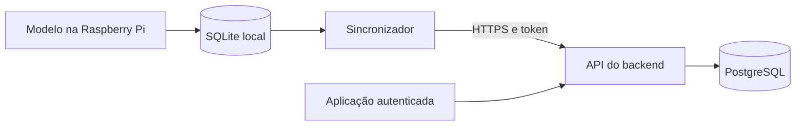

# Backend e integração com o banco de dados

Na Sprint 4, foi implementado o **backend** para cadastrar dispositivos, câmeras, aviários e lotes, receber os resultados da visão computacional e consultar o histórico. O código fica em `src/backend/`, com Node.js 22 ou superior, TypeScript e Fastify. O banco é PostgreSQL, executado localmente ou no Supabase. Os termos técnicos estão no [glossário](../sprint-1/glossario.md).

## Funcionamento e estrutura

O processamento das imagens permanece na Raspberry Pi. Cada análise é guardada no SQLite local e enviada pelo sincronizador à API. O backend valida os dados, grava os registros no PostgreSQL e disponibiliza consultas para a aplicação, conforme a Figura 1. Esse fluxo dá continuidade à [integração da Sprint 3](../sprint-3/integracao-no-banco.md).

**Figura 1 – Fluxo dos resultados até o banco de dados**



Fonte: elaborado pelos autores (2026).

| Local | Responsabilidade |
| --- | --- |
| `src/backend/src/` | Servidor, rotas, autenticação, validação e conexão com o banco |
| `src/backend/scripts/migrate.ts` | Comando de aplicação das migrações |
| `src/backend/tests/` | Testes da API, conexão, segurança e histórico de lotes |
| `src/database/` | Esquema SQL e migrações compartilhados com a integração existente |

## Dados armazenados

O esquema inicial foi complementado com os campos aprovados pela equipe e com o histórico de ocupação dos aviários.

| Tabela | Dados principais |
| --- | --- |
| `raspberry` | Nome, hostname, modelo e estado de ativação (`active`) |
| `camera` | Nome, modelo, dispositivo, aviário e estado de ativação |
| `aviary` | Nome, número, boxes, tipo, data de cadastro, fuso e lote atual |
| `lot` | Nome, idade em uma data de referência, origem dessa informação e data de arquivamento |
| `aviary_lot_assignment` | Lote e aviário associados, início e fim da ocupação |
| `analysis` | Identificadores, horários, status, contagens totais, modelo e registro JSON completo |
| `analysis_level_count` | Contagem e percentual de cada nível de uma análise |

Dispositivos e câmeras podem ser desativados sem excluir os registros. Nos lotes, idade, data de referência e origem da informação devem estar preenchidas juntas ou permanecer nulas. Uma análise inválida mantém contagens nulas; um quadro válido sem aves pode ter contagem zero.

### Lote no momento da captura

A análise é associada ao lote que ocupava o aviário em `capturado_em`. Assim, uma imagem capturada no lote 1 e enviada depois da entrada do lote 2 continua vinculada ao lote 1. Os intervalos de ocupação incluem o início e excluem o fim; uma captura no instante exato da troca pertence ao lote novo. O banco impede ocupações sobrepostas.

O gestor registra uma troca em `POST /aviaries/:id/lot-assignments`, informando `lot_id` e `effective_at`, com fuso horário. O backend encerra o período anterior e atualiza o lote atual na mesma transação. Enviar `lot_id: null` encerra a ocupação. O cadastro e o PATCH de `current_lot_id` também registram a mudança, usando o instante do comando.

Quando falta o horário da captura ou uma ocupação conhecida, `lot_id` fica nulo e o motivo aparece em `lot_association_status`. A migração `005` preserva os resultados anteriores como `legacy_unverified` e registra o lote atual somente a partir da migração. Datas históricas anteriores precisam ser confirmadas antes de completar o histórico.

## Rotas e acesso

| Rota | Operações e finalidade |
| --- | --- |
| `/raspberries`, `/cameras`, `/aviaries`, `/lots` | GET para listar e POST para cadastrar |
| Cada cadastro `/:id` | GET para consultar e PATCH para atualizar |
| `/aviaries/:id/lot-assignments` | GET do histórico e POST da troca de lote |
| `/ingest-analyses` | POST dos resultados enviados pelo nó de borda |
| `/analyses` e `/analyses/:id` | GET do histórico e do detalhe de uma análise |
| `/health` | GET público para verificar se a API responde |
| `/ready` e `/me` | GET autenticado para verificar o banco e consultar a identidade |

As listas de cadastros e análises têm paginação por `limit` e `offset`, com até 100 registros por página. O histórico de análises aceita filtros por câmera, aviário, lote, status e período. O envio mantém o contrato `schema_version: 1`, com `accepted_analysis_ids` e `rejected` na resposta: somente os identificadores persistidos são confirmados. Reenvios idênticos não duplicam resultados; novas análises de dispositivos ou câmeras inativas são recusadas.

As requisições protegidas usam `Authorization: Bearer TOKEN`. `RAIAR_API_TOKEN` é uma credencial de serviço para integrações entre servidores; `RAIAR_SYNC_TOKEN` é exclusivo da ingestão. Para usuários, a integração opcional com Supabase Auth valida o JWT e lê o perfil de `app_metadata.role`: gestor mantém os quatro cadastros e as ocupações; operador consulta os dados e mantém dispositivos e câmeras. O token de serviço não deve ser incluído no frontend.

## Execução local

Na raiz do repositório, com Node.js 22 ou superior instalado, execute no PowerShell:

```powershell
cd src/backend
npm ci
Copy-Item .env.exemplo .env
```

Edite `.env` com a conexão PostgreSQL e dois segredos distintos de pelo menos 32 caracteres. Para gerar cada segredo, execute:

```powershell
node -e "console.log(require('node:crypto').randomBytes(32).toString('hex'))"
```

| Variável | Configuração |
| --- | --- |
| `DATABASE_URL` | Endereço de conexão PostgreSQL; o exemplo usa o banco local |
| `DATABASE_SSL` | `false` para o banco local e `true` para conexões remotas |
| `RAIAR_API_TOKEN` | Segredo de acesso aos cadastros e consultas |
| `RAIAR_SYNC_TOKEN` | Segredo compartilhado com o sincronizador do nó |
| `HOST` e `PORT` | Por padrão, `127.0.0.1` e `3000` |

Para usar o PostgreSQL local fornecido pelo projeto, inicie o Docker Desktop e execute `docker compose up -d database` na pasta do backend. Com o banco disponível e o `.env` configurado, aplique as migrações e inicie a API:

```powershell
npm run migrate
npm run dev
```

A API responde em `http://127.0.0.1:3000`. As migrações `002` a `005` são aplicadas em ordem e controladas para evitar reaplicação ou alteração silenciosa de scripts já executados. A conexão reutiliza um pool e usa transações para operações relacionadas. Com `DATABASE_SSL=true`, TLS e verificação de certificado prevalecem sobre parâmetros da URL, incluindo `ssl=0` e `ssl=no-verify`.

Para conectar o nó, configure `RAIAR_SYNC_URL=https://SEU_BACKEND/ingest-analyses`, o mesmo `RAIAR_SYNC_TOKEN` e o ID numérico da câmera cadastrada. O HTTPS é exigido fora de localhost. O uso de Supabase requer uma conexão PostgreSQL, não a URL HTTP da API de dados. As opções completas estão em `src/backend/README.md`.

## Validação e limites

Os comandos de verificação, executados em `src/backend/`, são:

```powershell
npm run check
npm test
npm run build
```

A validação local da entrega registrou 35 testes aprovados e um teste com PostgreSQL externo não executado. Foram verificados os cadastros, autenticação, migrações, precedência do TLS, reenvios e associação histórica de lotes. Também foi validado o envio pelo sincronizador Python, com troca de lote entre captura e recebimento. O workflow `.github/workflows/backend.yml` configura um PostgreSQL de teste para executar a verificação externa no GitHub.

A publicação e a aplicação das migrações no ambiente da equipe dependem da configuração desse ambiente. O token de sincronização ainda é compartilhado entre os nós. Configuração remota da coleta, agregação histórica, telemetria, geração de alertas e retenção de imagens permanecem fora desta implementação.

