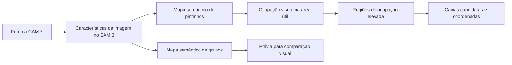

# YanNet para identificação de amontoamentos

Nesta sprint, desenvolvemos o **YanNet**, um protótipo para localizar regiões onde
as aves visíveis se agrupam no aviário. A unidade de análise é o grupo observado
na imagem. O resultado desta versão é uma caixa para cada **amontoamento
candidato**, acompanhada de uma estimativa de ocupação visual. O objetivo da
entrega completa inclui classificar cada grupo em baixa, média ou alta
compactação e registrar sua localização ao longo do vídeo.

Os níveis físicos do Jump Start ficam parcialmente encobertos nesse enquadramento.
Por isso, adotamos três faixas na imagem para organizar o relatório. O piloto
usa o SAM 3 com pesos pré-treinados [1]. Executamos o modelo sem ajuste dos pesos
e sem imagens anotadas do aviário. O código fica em `src/yannet/`.

## Dados e área de análise

Usamos uma foto de referência da **CAM 7**, com 1.238 × 564 pixels, para desenhar
as faixas e executar o primeiro ensaio de localização. Dividimos a área visível
em faixas esquerda, central e direita, com a plataforma na faixa central. Os
limites acompanham a perspectiva da câmera. O arquivo `cam7.json` guarda os
limites em coordenadas normalizadas em relação à largura e à altura do quadro.

Conferimos o desenho em um quadro da gravação, com 1.920 × 888 pixels. Reservamos
o trecho de **00:20 a 02:24**, com 124 segundos, para avaliar a versão em vídeo.
Esse intervalo mantém a CAM 7 em tela cheia e exclui as transições do aplicativo
nas pontas da gravação. A conferência das faixas usou um quadro do trecho, e o
ensaio de localização usou a foto de referência. Os arquivos de entrada e os
resultados completos ficam no armazenamento local. As prévias do ensaio estão
na seção de resultados desta página.

## Segmentação e formação das caixas

A **segmentação semântica** atribui a cada pixel uma pontuação de associação com
o conceito pedido ao modelo. Consultamos o SAM 3 com `chicks` (pintinhos) e
`cluster of chicks` (grupo de pintinhos), reaproveitando as características
visuais extraídas da foto [2]. A Figura 1 mostra como o primeiro mapa é
transformado em caixas e onde o segundo entra na inspeção.

**Figura 1 – Da imagem da CAM 7 às caixas candidatas**



Fonte: elaborado pelos autores (2026).

1. Redimensionamos o mapa de `chicks` para as dimensões da foto e marcamos como
   ocupados os pixels com pontuação de pelo menos 0,5 dentro da área útil. A
   área útil é a união das três faixas.
2. Calculamos a **ocupação visual local**, a fração de pixels marcados em uma
   janela quadrada ao redor de cada posição. Combinamos janelas menores no fundo e
   maiores no primeiro plano para acomodar a diferença aparente no tamanho das
   aves. Os tamanhos de referência vão de aproximadamente 3,3% a 15% da altura da
   imagem.
3. Marcamos as posições com ocupação de pelo menos 0,42 e reunimos os pixels
   marcados que estão conectados entre si. Cada região formada desse modo é um
   **componente conexo** [3]. Depois de descartar as regiões pequenas em relação à
   janela local, guardamos a caixa que envolve cada região e a maior ocupação
   local dentro dela.

O limiar de 0,42 é exploratório. A ocupação mede a cobertura estimada na imagem.
Ela ainda precisa de calibração para representar a compactação dos grupos em
classes. O JSON atual exporta coordenadas em pixels e ocupação local máxima. A
atribuição de cada caixa à faixa que contém seu centro faz parte do relatório
previsto para a execução em vídeo.

## Resultado do ensaio na foto

A rotina de ocupação gerou **seis caixas candidatas** na foto de referência. A
inspeção visual mostrou caixas em regiões com aves próximas no primeiro plano.
Também apareceram caixas compridas junto aos comedouros. O mapa consultado
diretamente com `cluster of chicks` destacou fileiras extensas nessas mesmas
áreas. Em ambos os casos, a proximidade na imagem pode juntar grupos distintos
em uma região. As seis caixas são propostas do algoritmo e ainda precisam de
revisão com outras imagens.

A Figura 2 mostra a segmentação de `chicks`, usada para calcular a ocupação
local. A Figura 3 mostra o resultado da consulta direta por grupos. Na Figura 4,
as caixas amarelas delimitam as regiões candidatas encontradas pela regra de
ocupação visual.

**Figura 2 – Segmentação de pintinhos na CAM 7**


Fonte: elaborado pelos autores (2026), a partir da saída `aves.jpg` do YanNet.

**Figura 3 – Segmentação por consulta direta de grupos na CAM 7**


Fonte: elaborado pelos autores (2026), a partir da saída `grupos.jpg` do YanNet.

**Figura 4 – Caixas candidatas a amontoamento na CAM 7**


Fonte: elaborado pelos autores (2026), a partir da saída `focos.jpg` do YanNet.

A Tabela 1 registra uma execução na CPU Intel Core i5-1345U, com quatro threads,
PyTorch 2.15.0 e Transformers 5.22.2. A medição usa uma única foto e começa
depois do carregamento do modelo.

**Tabela 1 – Tempos registrados no ensaio com a foto da CAM 7**

| Etapa medida | Tempo |
| --- | ---: |
| Extração das características da imagem | 50,34 s |
| Consulta e geração do mapa para `chicks` | 4,41 s |
| Consulta e geração do mapa para `cluster of chicks` | 4,16 s |

Fonte: elaborado pelos autores (2026), a partir de `execucao.json`.

O processo atingiu cerca de 4,10 GiB de pico de RAM. Os tempos da tabela cobrem
as etapas medidas e deixam de fora o download dos pesos e a gravação dos
arquivos de saída. O ensaio fornece uma verificação qualitativa da localização
em uma foto. A qualidade das caixas ao longo do vídeo, o erro de detecção e o
acerto por classe ainda precisam ser medidos.

## Como reproduzir o ensaio

Use Python 3.12 e coloque a foto em `src/yannet/referencia-cam7.png`. Solicite
acesso ao repositório `facebook/sam3` no Hugging Face com sua própria conta [4].
Após a liberação, crie um token de leitura e autentique no terminal com
`hf auth login`. A primeira execução baixa o arquivo de pesos de cerca de
3,44 GB para o cache local.

Na raiz do repositório, prepare o ambiente e execute na CPU.

```bash
python3.12 -m venv src/yannet/.venv
source src/yannet/.venv/bin/activate
python -m pip install --index-url https://download.pytorch.org/whl/cpu torch==2.15.0 torchvision==0.29.2
python -m pip install -r src/yannet/requirements-sam3.txt
hf auth login
PYTHONPATH=src python -m yannet.explorar_grupos \
  --foto src/yannet/referencia-cam7.png \
  --saida src/yannet/outputs/cam7-reproducao \
  --dispositivo cpu
```

A pasta indicada em `--saida` deve ser nova a cada execução. Consulte os
arquivos da Tabela 2 para revisar os resultados.

**Tabela 2 – Arquivos gerados pelo ensaio**

| Arquivo | Conteúdo |
| --- | --- |
| `focos.jpg` | Foto com as regiões de ocupação elevada e as caixas candidatas. |
| `focos.json` | Coordenadas em pixels de cada caixa e ocupação local máxima. |
| `aves.jpg` e `grupos.jpg` | Sobreposição dos mapas semânticos na foto. |
| `aves.npy` e `grupos.npy` | Mapas numéricos para reaproveitar os resultados da segmentação. |
| `execucao.json` | Conceitos consultados, tempos medidos e pico de RAM. |

Fonte: elaborado pelos autores (2026), a partir das saídas de `explorar_grupos.py`.

## Limitações e próximos passos

O próximo ensaio precisa de uma segunda gravação da CAM 7, no mesmo
enquadramento, para revisar caixas alongadas e ajustar a classificação. A
proposta é selecionar de seis a dez quadros com agrupamentos compactos, fileiras
espaçadas e grupos próximos entre si. Os mapas salvos permitem testar a regra
de formação das caixas sem repetir a segmentação.

Após a revisão, vamos calibrar as classes baixa, média e alta e avaliar a
configuração no trecho reservado. A entrega em vídeo prevê uma prévia anotada
e um CSV por detecção, com instante, faixa, classe e coordenadas da caixa.

## Referências {#referencias}

[1] CARION, N. et al. **SAM 3: Segment Anything with Concepts**. arXiv:2511.16719, 2025. Disponível em: [https://arxiv.org/abs/2511.16719](https://arxiv.org/abs/2511.16719). Acesso em: 16 nov. 2026.

[2] HUGGING FACE. **SAM3**. Transformers Documentation. Disponível em: [https://huggingface.co/docs/transformers/en/model_doc/sam3](https://huggingface.co/docs/transformers/en/model_doc/sam3). Acesso em: 16 nov. 2026.

[3] OPENCV. **Structural Analysis and Shape Descriptors**. Disponível em: [https://docs.opencv.org/4.x/d3/dc0/group__imgproc__shape.html](https://docs.opencv.org/4.x/d3/dc0/group__imgproc__shape.html). Acesso em: 16 nov. 2026.

[4] META. **facebook/sam3**. Hugging Face. Disponível em: [https://huggingface.co/facebook/sam3](https://huggingface.co/facebook/sam3). Acesso em: 16 nov. 2026.
