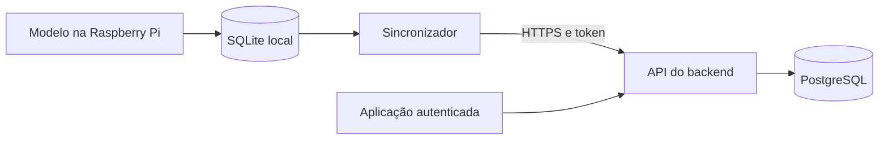
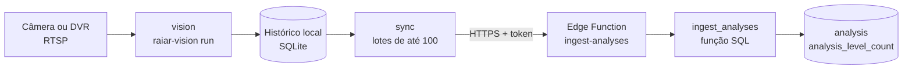
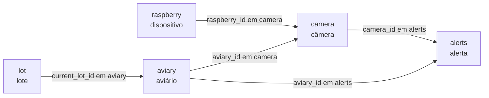

# Backend e armazenamento

Comece pela implementação atual do backend. As seções seguintes registram a integração do nó e o esquema inicial do banco, para explicar sua evolução. Na operação, use as migrações e o README do backend: o esquema inicial não contém todas as tabelas e regras atuais.

## Backend e integração com o banco de dados {#backend-backend-e-integração-com-o-banco-de-dados}

Na Sprint 4, foi implementado o backend para cadastrar dispositivos, câmeras, aviários e lotes, receber os resultados da visão computacional e consultar o histórico. O código fica em `src/backend/`, com Node.js 22 ou superior, TypeScript e Fastify. O banco é PostgreSQL, executado localmente ou no Supabase. Os termos técnicos estão no [glossário](../apoio/glossario.mdx#glossario-glossário-em-linguagem-simples).

### Funcionamento e estrutura {#backend-funcionamento-e-estrutura}

O processamento das imagens permanece na Raspberry Pi. Cada análise é guardada no SQLite local e enviada pelo sincronizador à API. O backend valida os dados, grava os registros no PostgreSQL e disponibiliza consultas para a aplicação, conforme a Figura 1. Esse fluxo dá continuidade à [integração da Sprint 3](backend.mdx#integracao-no-banco-integração-do-nó-de-borda-com-o-banco-de-dados).

**Figura 1 – Fluxo dos resultados até o banco de dados**



<p className="figure-source">Fonte: produzido pela equipe, 2026</p>

| Local | Responsabilidade |
| --- | --- |
| `src/backend/src/` | Servidor, rotas, autenticação, validação e conexão com o banco |
| `src/backend/scripts/migrate.ts` | Comando de aplicação das migrações |
| `src/backend/tests/` | Testes da API, conexão, segurança e histórico de lotes |
| `src/database/` | Esquema SQL e migrações compartilhados com a integração existente |

### Dados armazenados {#backend-dados-armazenados}

O esquema inicial foi complementado com os campos aprovados pela equipe e com o histórico de ocupação dos aviários.

| Tabela | Dados principais |
| --- | --- |
| `raspberry` | Nome, hostname, modelo e estado de ativação (`active`) |
| `camera` | Nome, modelo, dispositivo, aviário e estado de ativação |
| `aviary` | Nome, número, boxes, tipo, data de cadastro, fuso e lote atual |
| `lot` | Nome, idade em uma data de referência, origem dessa informação e data de arquivamento |
| `aviary_lot_assignment` | Lote e aviário associados, início e fim da ocupação |
| `analysis` | Identificadores, horários, status, contagens totais, modelo e registro JSON completo |
| `analysis_level_count` | Contagem e percentual de cada nível de uma análise |

Dispositivos e câmeras podem ser desativados sem excluir os registros. Nos lotes, idade, data de referência e origem da informação devem estar preenchidas juntas ou permanecer nulas. Uma análise inválida mantém contagens nulas; um quadro válido sem aves pode ter contagem zero.

#### Lote no momento da captura {#backend-lote-no-momento-da-captura}

A análise é associada ao lote que ocupava o aviário em `capturado_em`. Assim, uma imagem capturada no lote 1 e enviada depois da entrada do lote 2 continua vinculada ao lote 1. Os intervalos de ocupação incluem o início e excluem o fim; uma captura no instante exato da troca pertence ao lote novo. O banco impede ocupações sobrepostas.

O gestor registra uma troca em `POST /aviaries/:id/lot-assignments`, informando `lot_id` e `effective_at`, com fuso horário. O backend encerra o período anterior e atualiza o lote atual na mesma transação. Enviar `lot_id: null` encerra a ocupação. O cadastro e o PATCH de `current_lot_id` também registram a mudança, usando o instante do comando.

Quando falta o horário da captura ou uma ocupação conhecida, `lot_id` fica nulo e o motivo aparece em `lot_association_status`. A migração `005` preserva os resultados anteriores como `legacy_unverified` e registra o lote atual somente a partir da migração. Datas históricas anteriores precisam ser confirmadas antes de completar o histórico.

A Figura 2 exemplifica por que o horário de recebimento não pode definir o lote da imagem.

**Figura 2: Imagem enviada após a troca de lote**


<p className="figure-source">Fonte: produzido pela equipe, 2026</p>

O exemplo se baseia na regra de histórico de ocupação do backend.  Horários e identificações são fictícios. Diagrama produzido no Mermaid Live, exportado em SVG e convertido para PNG.

<div className="figure-links">

[Abrir imagem em tamanho original](/img/documentacao/lote-instante-captura.png). [Código Mermaid](/img/documentacao/lote-instante-captura.mmd).

</div>

### Rotas e acesso {#backend-rotas-e-acesso}

| Rota | Operações e finalidade |
| --- | --- |
| `/raspberries`, `/cameras`, `/aviaries`, `/lots` | GET para listar e POST para cadastrar |
| Cada cadastro `/:id` | GET para consultar e PATCH para atualizar |
| `/aviaries/:id/lot-assignments` | GET do histórico e POST da troca de lote |
| `/ingest-analyses` | POST dos resultados enviados pelo nó de borda |
| `/analyses` e `/analyses/:id` | GET do histórico e do detalhe de uma análise |
| `/health` | GET público para verificar se a API responde |
| `/ready` e `/me` | GET autenticado para verificar o banco e consultar a identidade |

As listas de cadastros e análises têm paginação por `limit` e `offset`, com até 100 registros por página. O histórico de análises aceita filtros por câmera, aviário, lote, status e período. O envio mantém o contrato `schema_version: 1`, com `accepted_analysis_ids` e `rejected` na resposta: somente os identificadores persistidos são confirmados. Reenvios idênticos não duplicam resultados; novas análises de dispositivos ou câmeras inativas são recusadas.

As requisições protegidas usam `Authorization: Bearer TOKEN`. `RAIAR_API_TOKEN` é uma credencial de serviço para integrações entre servidores; `RAIAR_SYNC_TOKEN` é exclusivo da ingestão. Para usuários, a integração opcional com Supabase Auth valida o JWT e lê o perfil de `app_metadata.role`: gestor mantém os quatro cadastros e as ocupações; operador consulta os dados e mantém dispositivos e câmeras. O token de serviço não deve ser incluído no frontend.

### Execução local {#backend-execução-local}

Na raiz do repositório, com Node.js 22 ou superior instalado, execute no PowerShell:

```powershell
cd src/backend
npm ci
Copy-Item .env.exemplo .env
```

Edite `.env` com a conexão PostgreSQL e dois segredos distintos de pelo menos 32 caracteres. Para gerar cada segredo, execute:

```powershell
node -e "console.log(require('node:crypto').randomBytes(32).toString('hex'))"
```

| Variável | Configuração |
| --- | --- |
| `DATABASE_URL` | Endereço de conexão PostgreSQL; o exemplo usa o banco local |
| `DATABASE_SSL` | `false` para o banco local e `true` para conexões remotas |
| `RAIAR_API_TOKEN` | Segredo de acesso aos cadastros e consultas |
| `RAIAR_SYNC_TOKEN` | Segredo compartilhado com o sincronizador do nó |
| `HOST` e `PORT` | Por padrão, `127.0.0.1` e `3000` |

Para usar o PostgreSQL local fornecido pelo projeto, inicie o Docker Desktop e execute `docker compose up -d database` na pasta do backend. Com o banco disponível e o `.env` configurado, aplique as migrações e inicie a API:

```powershell
npm run migrate
npm run dev
```

A API responde em `http://127.0.0.1:3000`. As migrações `002` a `005` são aplicadas em ordem e controladas para evitar reaplicação ou alteração silenciosa de scripts já executados. A conexão reutiliza um pool e usa transações para operações relacionadas. Com `DATABASE_SSL=true`, TLS e verificação de certificado prevalecem sobre parâmetros da URL, incluindo `ssl=0` e `ssl=no-verify`.

Para conectar o nó, configure `RAIAR_SYNC_URL=https://SEU_BACKEND/ingest-analyses`, o mesmo `RAIAR_SYNC_TOKEN` e o ID numérico da câmera cadastrada. O HTTPS é exigido fora de localhost. O uso de Supabase requer uma conexão PostgreSQL, não a URL HTTP da API de dados. As opções completas estão em `src/backend/README.md`.

### Validação e limites {#backend-validação-e-limites}

Os comandos de verificação, executados em `src/backend/`, são:

```powershell
npm run check
npm test
npm run build
```

A validação local da entrega registrou 35 testes aprovados e um teste com PostgreSQL externo não executado. Foram verificados os cadastros, autenticação, migrações, precedência do TLS, reenvios e associação histórica de lotes. Também foi validado o envio pelo sincronizador Python, com troca de lote entre captura e recebimento. O workflow `.github/workflows/backend.yml` configura um PostgreSQL de teste para executar a verificação externa no GitHub.

A publicação e a aplicação das migrações no ambiente da equipe dependem da configuração desse ambiente. O token de sincronização ainda é compartilhado entre os nós. Configuração remota da coleta, agregação histórica, telemetria, geração de alertas e retenção de imagens permanecem fora desta implementação.

## Integração do nó de borda com o banco de dados {#integracao-no-banco-integração-do-nó-de-borda-com-o-banco-de-dados}

Esta seção registra a integração inicial entre a captura no Raspberry Pi e o banco de dados, além das alterações no esquema inicial (`src/database/schema.sql`, descrito em [Banco de dados: primeira versão](backend.mdx#banco-de-dados-banco-de-dados-primeira-versão)) para recebê-la. O nó guarda cada análise primeiro em um histórico local e só depois a envia, de modo que uma queda de rede não perde resultados, como pede o RNF04. Os termos técnicos estão no [glossário](../apoio/glossario.mdx#glossario-glossário-em-linguagem-simples).

### Caminho dos dados {#integracao-no-banco-caminho-dos-dados}

**Figura 3 – Do quadro da câmera ao registro no banco**



<p className="figure-source">Fonte: produzido pela equipe, 2026</p>

O `vision` captura um quadro por câmera a cada intervalo e grava a análise no histórico local. O `sync` consulta o histórico a cada cinco minutos, envia as análises ainda não confirmadas e só marca como entregues os identificadores que o servidor devolve em `accepted_analysis_ids`. A Edge Function confere o token e entrega o lote à função SQL `ingest_analyses`, que grava as análises e informa quais aceitou.

### Contrato do envio {#integracao-no-banco-contrato-do-envio}

O `sync` faz um `POST` com o cabeçalho `Authorization: Bearer TOKEN` e o corpo abaixo. O token é o valor de `RAIAR_SYNC_TOKEN` no `.env` do nó.

```json
{
  "schema_version": 1,
  "analyses": [
    {
      "analise_id": "11111111-1111-4111-8111-111111111111",
      "camera_id": "1",
      "quadro_id": "…",
      "capturado_em": "2026-11-03T10:00:00+00:00",
      "processado_em": "2026-11-03T10:00:02+00:00",
      "status": "valido",
      "quantidade_aves_visiveis": 3,
      "contagens_por_nivel": {"N0": 1, "N1": 2},
      "percentuais_por_nivel": {"N0": 33.3, "N1": 66.7},
      "modelo_versao": "…"
    }
  ]
}
```

A resposta de sucesso é `200` com `{"accepted_analysis_ids": [...], "rejected": [{"id": "...", "reason": "..."}]}`. O nó só dá por entregues os identificadores aceitos; os rejeitados continuam na fila e são reenviados no ciclo seguinte. O `sync` mostra no seu resultado o total de recusas (`rejected_count`) e o motivo das dez primeiras (`rejected`), e a [lista de mensagens e correções](captura-operacao.mdx#falhas-e-do-teste-para-producao-mapa-de-falhas) diz o que fazer com cada motivo.

**Tabela 1 – Respostas da Edge Function**

| Código | Quando acontece | Efeito no nó |
| --- | --- | --- |
| 200 | Lote válido, mesmo que alguns itens sejam rejeitados | Marca como entregues só os identificadores aceitos |
| 400 | JSON inválido, `schema_version` diferente de 1 ou mais de 500 análises | O `sync` falha e tudo permanece pendente |
| 401 | Token ausente ou errado | O `sync` falha e tudo permanece pendente |
| 405 | Método diferente de `POST` | O `sync` falha e tudo permanece pendente |
| 502 | O banco devolveu erro (o detalhe fica só no log da função) | O `sync` falha e tudo permanece pendente |

<p className="figure-source">Fonte: produzido pela equipe, 2026</p>

A elaboração se baseou em `supabase/functions/ingest-analyses/handler.ts`.

### Extensão do esquema {#integracao-no-banco-extensão-do-esquema}

O esquema inicial não tem onde guardar as análises, apenas os alertas. A proposta está em `src/database/migrations/002_analises.sql` e precisa de revisão do responsável pelo banco antes de ir para produção. Ela acrescenta duas tabelas e a função de ingestão.

**Tabela 2 – Tabelas acrescentadas**

| Tabela | Conteúdo |
| --- | --- |
| `analysis` | Uma linha por análise: `id` (o `analise_id` do nó), câmera, aviário, lote atual no momento do recebimento, horários de captura e de processamento, `status`, contagens totais, versão do modelo e o registro completo em `payload` (`jsonb`) |
| `analysis_level_count` | Uma linha por nível de cada análise, com `bird_count` e `percent` |

<p className="figure-source">Fonte: produzido pela equipe, 2026</p>

A elaboração se baseou em `src/database/migrations/002_analises.sql`.

Decisões da integração inicial:

- **A câmera define o aviário.** O nó envia só o `camera_id`; a função consulta `camera.aviary_id`. Por isso, `RAIAR_CAMERA_ID` no nó deve ser o `camera.id` numérico cadastrado no banco, e não um nome como `camera-1`.
- **Câmera não cadastrada é rejeitada, não perdida.** A análise continua na fila do nó e é aceita quando a câmera for cadastrada. Se o cadastro nunca vier, as análises ficam pendentes para sempre e ocupam a fila: lotes cheios de rejeitadas podem atrasar as demais.
- **O lote é o atual no recebimento.** `analysis.lot_id` copia `aviary.current_lot_id` quando o lote chega, como o esquema inicial só guarda o lote atual. Uma análise que fique muito tempo na fila pode ser ligada a um lote que já mudou.
- **O reenvio é idempotente.** A chave primária é o `analise_id`; reenviar uma análise já gravada não a duplica nem repete as contagens por nível.
- **Sem alertas.** Esta versão grava as análises, mas não gera linhas em `alerts`; a regra de quando uma contagem vira alerta ainda não foi definida.
- **Acesso fechado.** As duas tabelas têm RLS ligado (a segurança por linha do PostgreSQL) e nenhuma política, então só a chave de serviço do Supabase, usada pela Edge Function, as acessa. Essa chave nunca vai para o Raspberry Pi.

### Como colocar no ar {#integracao-no-banco-como-colocar-no-ar}

Estes passos ainda não foram executados no Supabase da equipe.

1. Aplicar `src/database/schema.sql` e, depois, `src/database/migrations/002_analises.sql` no banco, se as tabelas ainda não existirem.
2. Cadastrar o Raspberry Pi, o aviário e a câmera, e anotar o `camera.id`.
3. Definir o segredo da função com `supabase secrets set RAIAR_SYNC_TOKEN=VALOR_SECRETO`.
4. Publicar com `supabase functions deploy ingest-analyses --no-verify-jwt`. A verificação padrão de JWT é desligada porque o nó se autentica pelo próprio token.
5. No `.env` do nó, definir `RAIAR_SYNC_URL=https://PROJECT_REF.supabase.co/functions/v1/ingest-analyses`, o mesmo `RAIAR_SYNC_TOKEN` e `RAIAR_CAMERA_ID` com o `camera.id`.

### O que foi validado {#integracao-no-banco-o-que-foi-validado}

**Tabela 3 – Situação das partes da integração**

| Parte | Como foi verificada | Situação |
| --- | --- | --- |
| Função SQL `ingest_analyses` | Executada em um Postgres 16 em container, com o esquema inicial: lote aceito, câmera inexistente e identificador inválido rejeitados sem derrubar o lote, reenvio sem duplicação | Validada |
| Manipulador da Edge Function (`handler.ts`) | Seis testes em Deno: token, método, formato, erro do banco sem vazar detalhe | Validado |
| Ligação da função ao Supabase (`index.ts`) | Não executada: depende do projeto Supabase e do CLI | Não validada |
| Fluxo do nó até o banco | Captura simulada, `sync` e Postgres em container, com um servidor de teste no lugar da Edge Function | Validado no notebook |
| Raspberry Pi | Não houve execução da versão com `run` no nó | Não validado |

<p className="figure-source">Fonte: produzido pela equipe, 2026</p>

## Banco de dados: primeira versão {#banco-de-dados-banco-de-dados-primeira-versão}

Esta seção registra o esquema inicial de lotes, aviários, Raspberry Pis, câmeras e alertas. O aviário é o espaço físico; o lote é o grupo de aves que o ocupa. Na Raiar, cada lote ocupa um aviário, mas a identificação do espaço precisa continuar estável quando o lote muda. A separação atende à distinção proposta no [dicionário de dados](dados.mdx#dicionario-de-dados-dicionário-de-dados-e-coleta-inicial) e ao cadastro previsto no requisito RF02 dos [requisitos](requisitos.mdx#requisitos-requisitos-funcionais-e-não-funcionais).

Cada aviário pode ser dividido em boxes, que são divisões internas do espaço. Seus identificadores ficam na coluna `aviary.box_identifiers`, como uma lista de nomes ou códigos. O termo também está definido no [glossário](../apoio/glossario.mdx#glossario-glossário-em-linguagem-simples).

O código desta versão está em `src/database/schema.sql`. O script cria todas as tabelas em um banco PostgreSQL que ainda não as contenha. A presença do arquivo no repositório não comprova que ele já foi executado em um banco em operação.

### Entidades e relacionamentos {#banco-de-dados-entidades-e-relacionamentos}

Cada tabela tem um identificador próprio. As chaves estrangeiras ligam um registro ao identificador de outra tabela; por exemplo, `camera.aviary_id` aponta para `aviary.id`. A Figura 4 mostra esses vínculos. O texto sobre cada seta é o campo que guarda a referência.

**Figura 4 – Relações entre lotes, aviários, dispositivos, câmeras e alertas**



<p className="figure-source">Fonte: produzido pela equipe, 2026</p>

A elaboração se baseou em `src/database/schema.sql`.

| Relação | Quantidade permitida | Regra no banco |
| --- | --- | --- |
| `lot` → `aviary` | Um aviário pode ter zero ou um lote atual; um lote pode ser atual em zero ou um aviário | `aviary.current_lot_id` aceita `null`, referencia `lot.id` e é único |
| `raspberry` → `camera` | Um Raspberry Pi pode ter várias câmeras; cada câmera tem exatamente um Raspberry Pi | `camera.raspberry_id` é obrigatório e referencia `raspberry.id` |
| `aviary` → `camera` | Um aviário pode ter várias câmeras; cada câmera pertence a um aviário | `camera.aviary_id` é obrigatório e referencia `aviary.id` |
| `camera` e `aviary` → `alerts` | Uma câmera e um aviário podem ter vários alertas; cada alerta indica uma câmera e um aviário | A chave estrangeira composta exige que o aviário do alerta seja o mesmo da câmera |

**Exemplo fictício:** o lote `31` ocupa atualmente o aviário `7`; a câmera `12` pertence a esse aviário e está associada ao Raspberry Pi `4`. Um alerta com `camera_id = 12` e `aviary_id = 7` respeita as relações. Se o mesmo alerta trouxer `aviary_id = 8`, o banco o rejeita, mesmo que o aviário `8` exista, porque essa não é a associação da câmera `12`.

### Campos e regras {#banco-de-dados-campos-e-regras}

As tabelas a seguir apresentam os nomes e tipos do PostgreSQL. Obrigatório significa `NOT NULL`; uma chave estrangeira só aceita valores que existam na tabela referenciada. Os campos `id` declarados como `GENERATED ALWAYS AS IDENTITY` são gerados pelo banco. Os exemplos desta página são fictícios.

#### Lote (`lot`) {#banco-de-dados-lote-lot}

| Campo | Tipo | Obrigatório | Significado e regra |
| --- | --- | --- | --- |
| `id` | `integer` | Sim | Chave primária gerada automaticamente. É a referência estável do grupo de aves, inclusive quando o nome usado pela equipe mudar. |
| `name` | `character varying` | Sim | Nome ou código operacional do lote. O banco exige um valor, mas não impede que dois lotes tenham o mesmo nome; para distingui-los, usa-se `id`. |

O lote não guarda o identificador de um aviário: a associação ativa fica em `aviary.current_lot_id`. Assim, o mesmo aviário pode receber um novo lote sem trocar seu próprio `id`. O cadastro inicial do lote ainda não contém idade, data de alojamento ou quantidade de aves. Esses dados são descritos como necessários ou desejáveis no [dicionário de dados](dados.mdx#dicionario-de-dados-dicionário-de-dados-e-coleta-inicial), mas não fazem parte deste esquema.

#### Aviário (`aviary`) {#banco-de-dados-aviário-aviary}

| Campo | Tipo | Obrigatório | Significado e regra |
| --- | --- | --- | --- |
| `id` | `integer` | Sim | Chave primária gerada automaticamente. Identifica o espaço físico e é o valor usado por `camera.aviary_id` e `alerts.aviary_id`. |
| `name` | `character varying` | Sim | Nome operacional do aviário, usado para reconhecê-lo em cadastros e consultas. Não precisa ser único. |
| `number` | `integer` | Sim | Número atribuído ao aviário. O banco exige seu preenchimento, mas permite números repetidos e não define faixa válida. |
| `box_identifiers` | `text[]` | Não | Lista de identificadores dos boxes internos, por exemplo `ARRAY['B1', 'B2', 'B3']`. Cada item é um texto. Pode ser `null` enquanto a lista ainda não tiver sido cadastrada. |
| `type` | `character varying` | Sim | Classifica o aviário como `rearing` (recria) ou `normal` (aves maduras destinadas à postura). Outros valores são rejeitados pelo `CHECK`. |
| `registration_date` | `date` | Sim | Data de cadastro do aviário. Se omitida, recebe `CURRENT_DATE`; não representa a data de chegada nem a idade do lote atual. |
| `current_lot_id` | `integer` | Não | Referência a `lot.id` para o lote que ocupa o aviário agora. Pode ser `null` quando não houver lote associado; `UNIQUE` impede o mesmo lote atual em dois aviários. |

`id` identifica o local, enquanto `current_lot_id` identifica quem o ocupa neste momento. Alterar `current_lot_id` atualiza apenas essa associação atual; o esquema não registra a data dessa troca nem o lote anterior.

`box_identifiers` descreve as divisões do aviário. Por exemplo, o aviário `7` pode ter os boxes `B1`, `B2` e `B3`, e outro aviário pode usar os mesmos códigos para suas próprias divisões. A identificação de um box depende do aviário ao qual ele pertence. O tipo `text[]` armazena os nomes em uma única lista; a aplicação deverá padronizar esses nomes e evitar itens vazios ou repetidos, pois o esquema atual não impõe essas validações.

Câmeras e alertas mantêm o vínculo com `aviary.id`. A lista de boxes é uma informação do cadastro do aviário e ainda não cria uma associação de câmera ou alerta com uma divisão específica.

#### Raspberry Pi (`raspberry`) {#banco-de-dados-raspberry-pi-raspberry}

| Campo | Tipo | Obrigatório | Significado e regra |
| --- | --- | --- | --- |
| `id` | `integer` | Sim | Chave primária gerada automaticamente. As câmeras usam esse valor em `camera.raspberry_id`. |
| `name` | `character varying` | Sim | Nome amigável para a equipe identificar o dispositivo; o banco permite nomes repetidos. |
| `hostname` | `character varying` | Sim | Nome atribuído ao dispositivo na rede. A restrição `UNIQUE` impede dois cadastros com o mesmo valor. |
| `model` | `character varying` | Não | Modelo do Raspberry Pi ou outra descrição do hardware, se conhecido. Pode ficar vazio. |

`name` serve à identificação humana, enquanto `hostname` identifica o cadastro pelo nome de rede. O banco não limita quantas câmeras podem apontar para o mesmo `raspberry.id`.

#### Câmera (`camera`) {#banco-de-dados-câmera-camera}

| Campo | Tipo | Obrigatório | Significado e regra |
| --- | --- | --- | --- |
| `id` | `integer` | Sim | Chave primária gerada automaticamente. Os alertas usam esse valor em `alerts.camera_id`. |
| `raspberry_id` | `integer` | Sim | Chave estrangeira para `raspberry.id`; informa a qual dispositivo a câmera está associada. Um ID inexistente é rejeitado. |
| `model` | `character varying` | Não | Modelo da câmera, se conhecido. É independente de `raspberry.model` e pode ficar vazio. |
| `aviary_id` | `integer` | Sim | Chave estrangeira para `aviary.id`; indica o aviário ao qual a câmera está vinculada. Um ID inexistente é rejeitado. |

A câmera precisa ter simultaneamente um Raspberry Pi e um aviário cadastrados. A restrição `UNIQUE (id, aviary_id)` permite que o alerta referencie o par câmera–aviário e confira se ambos correspondem. O vínculo com o Raspberry Pi é um cadastro lógico; a forma de obter o vídeo pelo servidor de câmeras ainda depende das verificações descritas na [arquitetura preliminar](../funcionamento.mdx#arquitetura-preliminar-arquitetura-preliminar-de-medição-por-nível).

#### Alerta (`alerts`) {#banco-de-dados-alerta-alerts}

| Campo | Tipo | Obrigatório | Significado e regra |
| --- | --- | --- | --- |
| `id` | `integer` | Sim | Chave primária gerada automaticamente; distingue cada ocorrência de alerta. |
| `camera_id` | `integer` | Sim | ID da câmera de origem. É validado junto com `aviary_id` pela chave estrangeira composta. |
| `aviary_id` | `integer` | Sim | ID do aviário associado à ocorrência. Precisa existir em `aviary` e corresponder ao aviário cadastrado para a câmera. |
| `datetime` | `timestamp without time zone` | Sim | Data e hora informadas para o alerta. Quando omitidas, recebem o horário corrente do banco; o campo não guarda fuso ou deslocamento UTC. |
| `alarm_type` | `character varying` | Sim | Categoria informada para o alerta. O campo é obrigatório, mas o banco ainda não define uma lista de categorias permitidas. |

A restrição composta `alerts_camera_aviary_fkey` exige que `(camera_id, aviary_id)` corresponda a `(id, aviary_id)` na tabela `camera`. A chave estrangeira `alerts_aviary_id_fkey` também confirma que o aviário existe. O alerta guarda `aviary_id` explicitamente para identificar o local no próprio registro; o par de IDs impede que ele seja diferente do aviário da câmera. `datetime` não distingue, por si só, o horário em que a situação ocorreu do horário em que o registro foi inserido: essa convenção ainda precisa ser definida.

### Criação do esquema {#banco-de-dados-criação-do-esquema}

O script cria `raspberry` e `lot` primeiro, depois `aviary`, `camera` e `alerts`, respeitando a ordem das chaves estrangeiras. A criação ocorre em uma transação: se algum comando falhar, nenhuma das tabelas criadas nessa execução é confirmada. O arquivo destina-se à criação inicial das tabelas e não altera registros de um esquema anterior.

Para associar um lote a um aviário, é necessário cadastrar o lote em `lot` e preencher `aviary.current_lot_id` com seu identificador. Um aviário recém-cadastrado pode ficar sem lote atual.

Os identificadores dos boxes podem ser informados no cadastro do aviário ou atualizados depois. No exemplo fictício abaixo, o aviário `7` recebe uma lista com três boxes. O valor atribuído substitui a lista completa anteriormente cadastrada nesse campo:

```sql
UPDATE public.aviary
SET box_identifiers = ARRAY['B1', 'B2', 'B3']::text[]
WHERE id = 7;
```

### Como consultar as relações {#banco-de-dados-como-consultar-as-relações}

Para localizar a câmera e o aviário de um alerta, `alerts.camera_id` aponta para `camera.id` e `alerts.aviary_id` aponta para `aviary.id`. A partir do aviário, `current_lot_id` permite consultar o lote atual. A consulta abaixo mostra esses vínculos para um alerta específico:

```sql
SELECT
  a.id AS alert_id,
  a.datetime,
  a.alarm_type,
  c.id AS camera_id,
  r.name AS raspberry_name,
  v.id AS aviary_id,
  v.name AS aviary_name,
  v.box_identifiers,
  l.id AS current_lot_id,
  l.name AS current_lot_name
FROM public.alerts AS a
JOIN public.camera AS c
  ON c.id = a.camera_id AND c.aviary_id = a.aviary_id
JOIN public.raspberry AS r ON r.id = c.raspberry_id
JOIN public.aviary AS v ON v.id = a.aviary_id
LEFT JOIN public.lot AS l ON l.id = v.current_lot_id
WHERE a.id = 1;
```

O `LEFT JOIN` mantém o alerta na consulta quando o aviário está sem lote atual. Se o lote do aviário tiver mudado depois do alerta, as colunas `current_lot_id` e `current_lot_name` mostrarão o lote de hoje, não o lote presente quando o alerta ocorreu.
