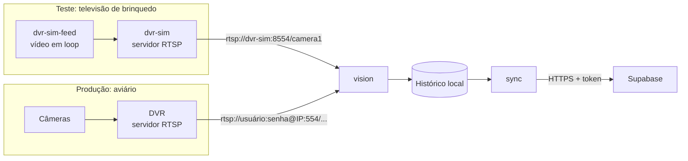

# Captura e operação


## Nó de borda e containers {#index-nó-de-borda-e-containers}

Na Sprint 3, preparamos o nó de borda, o computador que executará os modelos no aviário, e o material para empacotar os modelos da Sprint 2 em containers. Um container é um pacote que leva o programa e tudo o que ele precisa, para funcionar igual em qualquer equipamento. O objetivo é que os modelos rodem no Raspberry Pi e enviem seus resultados ao backend. A origem das imagens segue a [arquitetura preliminar](../funcionamento.mdx#arquitetura-preliminar-arquitetura-preliminar-de-medição-por-nível), cujo acesso ao servidor de câmeras ainda será validado com a Raiar. Os termos técnicos estão no [glossário](../apoio/glossario.mdx#glossario-glossário-em-linguagem-simples).


Os scripts de provisionamento estão em `src/edge/`.

## DVR simulado e teste na prática {#dvr-simulado-e-teste-na-pratica-dvr-simulado-e-teste-na-prática}

Esta página explica de um jeito simples o que a equipe fez para testar a captura de imagens sem ter acesso ao DVR do aviário e o que ainda precisa ser feito para testar com as câmeras de verdade. Quem quiser ver os problemas que podem aparecer e onde corrigi-los deve ler também [Falhas e do teste para a produção](captura-operacao.mdx#falhas-e-do-teste-para-producao-falhas-e-do-teste-para-a-produção). Os termos técnicos estão no [glossário](../apoio/glossario.mdx#glossario-glossário-em-linguagem-simples).

A Figura 1 mostra a ligação de rede proposta para o teste no aviário. O DVR real ainda precisa ser verificado; o esquema não registra uma montagem homologada.

**Figura 1: Conexão proposta entre DVR, rede local e Raspberry Pi**


<p className="figure-source">Fonte: produzido pela equipe, 2026</p>

O diagrama se baseia no procedimento de captura.  Acesso, canal, formato do vídeo e permissão de leitura dependem de confirmação com a Raiar. Diagrama produzido no Mermaid Live, exportado em SVG e convertido para PNG.

<div className="figure-links">

[Abrir imagem em tamanho original](/img/documentacao/conexao-dvr-dispositivo.png). [Código Mermaid](/img/documentacao/conexao-dvr-dispositivo.mmd).

</div>

### O que o DVR simulado reproduz {#dvr-simulado-e-teste-na-pratica-em-linguagem-simples}

Imagine uma televisão com muitos canais. Cada canal mostra uma câmera diferente do aviário. Essa televisão é o DVR, o aparelho que recebe as câmeras e as entrega pela rede.

O Raspberry Pi é um vigia pequeno. Ele olha para um canal, tira uma "foto" a cada 5 segundos, conta quantas galinhas aparecem em cada nível e anota o resultado num caderno. De tempos em tempos, um entregador leva as anotações do caderno para o escritório, que é o banco de dados.

Para treinar o vigia antes de ele ir para o aviário, a equipe montou uma televisão de brinquedo: um aparelho que toca, sem parar, um vídeo gravado no "canal 1". O vigia não percebe a diferença, porque pede o vídeo do mesmo jeito que pediria ao DVR de verdade. Assim, é possível descobrir se o vigia, o caderno e o entregador funcionam sem precisar estar no aviário.

**Tabela 1 – As peças da brincadeira e do projeto**

| Peça | Na brincadeira | No projeto | Nome no `compose.yaml` |
| --- | --- | --- | --- |
| DVR | A televisão com muitos canais | O gravador do aviário, que entrega cada câmera por uma URL **RTSP** | (não está no repositório) |
| DVR simulado | A televisão de brinquedo | Um servidor RTSP de teste (MediaMTX) | `dvr-sim` |
| Alimentador | A fita de vídeo tocando em loop | O `ffmpeg`, que repete um vídeo do repositório sem recodificá-lo | `dvr-sim-feed` |
| Vigia | O vigia que olha um canal | O programa `raiar-vision run`, que lê as câmeras e conta as aves | `vision` |
| Caderno | O caderno de anotações | O histórico local (SQLite), que sobrevive a quedas de rede | pasta `RAIAR_DATA` |
| Entregador | Quem leva o caderno ao escritório | O `raiar-vision sync`, que envia os resultados a cada 5 minutos | `sync` |
| Escritório | A sala onde as anotações ficam guardadas | O banco no Supabase | (nuvem) |

<p className="figure-source">Fonte: produzido pela equipe, 2026</p>

**Figura 1 – O teste e o uso real percorrem o mesmo caminho a partir do vigia**



<p className="figure-source">Fonte: produzido pela equipe, 2026</p>

### O que a simulação provou e o que não provou {#dvr-simulado-e-teste-na-pratica-o-que-a-simulação-provou-e-o-que-não-provou}

A simulação respondeu a perguntas sobre o nosso código. Ela não respondeu a perguntas sobre o equipamento do aviário.

**Tabela 2 – Alcance da simulação**

| Pergunta | Resposta | Como foi verificado |
| --- | --- | --- |
| O programa lê uma câmera por RTSP e grava uma análise a cada 5 s? | Sim | Execução no notebook com o `dvr-sim` |
| O que acontece se o DVR cair e voltar? | O `vision` avisa a queda, não grava análises repetidas e volta sozinho | Parada do `dvr-sim` por 25 s |
| Várias câmeras ao mesmo tempo funcionam? | Sim, no notebook, com 3 câmeras: duas boas e uma com URL errada | Execução com um `cameras.yaml` de 3 câmeras |
| Uma câmera com URL errada atrapalha as outras? | Não: as outras seguiram gravando, e a errada gerou uma mensagem por tentativa | Mesma execução |
| A senha da URL vai parar no histórico ou nos avisos? | Não: a URL é gravada sem usuário e senha | Busca da senha no histórico, que não a encontrou |
| O envio ao banco evita duplicatas? | Sim | Reenvio das mesmas análises |
| O DVR da Raiar funciona com o projeto? | **Não sabemos** | Não foi testado |
| O Raspberry Pi aguenta o captador contínuo? | **Não sabemos** | A execução foi no notebook, não no nó |
| O modelo conta bem as aves nos níveis? | **Não sabemos** | O vídeo de teste não tem zonas calibradas e o modelo `coco` não detectou aves nele |

<p className="figure-source">Fonte: produzido pela equipe, 2026</p>

A elaboração se baseou nas execuções de 3 de novembro de 2026.

### Como repetir a simulação {#dvr-simulado-e-teste-na-pratica-como-repetir-a-simulação}

Estes passos servem para qualquer pessoa que baixar o projeto. Eles exigem Docker com Compose e um terminal na raiz do repositório.

1. Copie o arquivo de exemplo e edite o `.env`:

   ```bash
   cp .env.exemplo .env
   ```

   Para a simulação, `RAIAR_CAMERA_SOURCE` deve ser `rtsp://dvr-sim:8554/camera1`. O `RAIAR_SYNC_URL` e o `RAIAR_SYNC_TOKEN` são obrigatórios mesmo no teste; se você não tem banco, deixe os valores de exemplo, e o `sync` apenas vai falhar e guardar tudo como pendente.

2. Construa a imagem e suba o DVR simulado, o `vision` e o `sync`:

   ```bash
   docker compose --env-file .env --profile captura --profile simulacao up -d --build
   ```

3. Acompanhe o vigia. A cada cerca de 5 segundos deve aparecer uma linha como esta:

   ```bash
   docker compose --profile captura --profile simulacao logs -f vision
   ```

   ```text
   camera=1 status=valido aves=0 niveis={}
   ```

   O modelo `coco` não é bom para contar galinhas, então `aves=0` é normal. Vale olhar o `status=valido`, que mostra que o caminho dos dados funciona. Os `niveis={}` vazios aparecem porque o teste não tem zonas calibradas.

4. Para ver o vigia lidar com uma queda, pare o DVR de brinquedo, espere meio minuto e ligue-o de novo:

   ```bash
   docker compose --profile simulacao stop dvr-sim
   docker compose --profile simulacao start dvr-sim
   ```

   Nos logs aparecem `camera=1 queda: tentativa N: ...` enquanto ele está parado e `camera=1 recuperada: voltou a entregar quadros` depois.

5. Para encerrar e apagar o que o teste criou:

   ```bash
   docker compose --profile captura --profile simulacao down -v
   ```

   Os dados do histórico ficam na pasta `RAIAR_DATA` (por padrão, `/opt/raiar/data`) e não são apagados por esse comando.

### Como testar na prática com o DVR de verdade {#dvr-simulado-e-teste-na-pratica-como-testar-na-prática-com-o-dvr-de-verdade}

A diferença entre o teste e o aviário está em um único endereço: no lugar da URL do `dvr-sim`, o vigia recebe a URL de um canal do DVR real. Todo o resto depende de conseguir essa URL e de ela funcionar.

1. **Perguntar à Raiar** a marca e o modelo do DVR, se o RTSP está habilitado, o IP (de preferência fixo), um usuário só com permissão de leitura, quantos canais existem e qual canal corresponde a cada ponto do aviário. Peça também o *substream*, o segundo fluxo de menor resolução, em H.264, porque decodificar H.265 no Raspberry Pi pesa no orçamento de CPU.
2. **Descobrir a URL do canal.** O formato muda conforme a marca. Os exemplos abaixo são comuns, mas precisam ser confirmados no manual do DVR:

   ```text
   rtsp://USUARIO:SENHA@IP_DO_DVR:554/cam/realmonitor?channel=1&subtype=1
   rtsp://USUARIO:SENHA@IP_DO_DVR:554/Streaming/Channels/102
   ```

3. **Testar a URL antes de usar o projeto.** No Raspberry Pi, o comando abaixo pergunta ao DVR qual vídeo ele entrega, sem rodar nenhum modelo. Se a resposta for algo como `h264,1280,720`, a URL está certa. Se travar ou der erro, o problema é da URL, do usuário, da senha, da rede ou do DVR, e não do projeto:

   ```bash
   docker run --rm --network host --entrypoint ffprobe raiar/vision:0.1.0 \
     -rtsp_transport tcp -v error -show_entries stream=codec_name,width,height \
     -of csv=p=0 "rtsp://USUARIO:SENHA@IP_DO_DVR:554/CAMINHO"
   ```

4. **Começar com um canal.** Coloque a URL em `RAIAR_CAMERA_SOURCE` no `.env`, deixe `RAIAR_CAMERA_ID` com o número da câmera cadastrada no banco e suba **sem** o perfil de simulação:

   ```bash
   docker compose --env-file .env --profile captura up -d
   ```

5. **Conferir os três pontos de passagem.** Primeiro, as linhas `camera=... status=valido` nos logs do `vision`. Depois, o `sync` sem recusas. Por fim, as linhas na tabela `analysis` do banco. Se algum deles falhar, o [mapa de falhas](captura-operacao.mdx#falhas-e-do-teste-para-producao-mapa-de-falhas) diz onde olhar.
6. **Só depois, acrescentar mais canais** (próxima seção) e deixar rodar por 24 horas para medir CPU, memória e temperatura, como pedem o RNF11 e o RNF12.

### Escolher quais câmeras o Raspberry Pi usa {#dvr-simulado-e-teste-na-pratica-escolher-quais-câmeras-o-raspberry-pi-usa}

A lista de câmeras que o vigia observa fica em um arquivo, `config/cameras.yaml`, dentro da pasta `RAIAR_CONFIG` do Raspberry Pi (por padrão, `/opt/raiar/config`). Se esse arquivo existir, ele vale no lugar de `RAIAR_CAMERA_SOURCE`.

```yaml
cameras:
  - id: 1
    source: rtsp://USUARIO:SENHA@IP_DO_DVR:554/CAMINHO_DO_CANAL_1
    interval_seconds: 5
    zones: config/zonas-camera-1.yaml
  - id: 2
    source: rtsp://USUARIO:SENHA@IP_DO_DVR:554/CAMINHO_DO_CANAL_2
    enabled: false
```

**Tabela 3 – Campos de cada câmera**

| Campo | Obrigatório | Significado |
| --- | --- | --- |
| `id` | Sim | O `camera.id` cadastrado no banco, um número. É por ele que o banco descobre o aviário |
| `source` | Sim | A URL RTSP, `/dev/video0` (USB) ou o caminho de um arquivo de vídeo |
| `interval_seconds` | Não | Segundos entre quadros. O padrão e o mínimo são 5 |
| `enabled` | Não | `false` desliga a câmera sem apagá-la da lista. O padrão é `true` |
| `zones` | Não | Arquivo de zonas **desta** câmera. Sem ele, a câmera é analisada sem níveis |
| `lote_id` | Não | Informativo. O banco usa o lote atual do aviário, e não este valor |

<p className="figure-source">Fonte: produzido pela equipe, 2026</p>

A elaboração se baseou em `src/chicken_yolo/live.py`.

Para trocar a seleção, edite o arquivo e reinicie o vigia, porque a lista só é lida na partida:

```bash
docker compose --profile captura restart vision
```

Cada câmera precisa do seu próprio arquivo de zonas, pois as zonas são calibradas para um enquadramento. Dentro do arquivo, `camera_id` deve ser igual ao `id` da câmera no `cameras.yaml`, e `calibrated: true` precisa estar presente. Sem isso, as análises saem como `imagem_inadequada`.

Três limites desta etapa:

- **Não existe tela para escolher as câmeras.** Hoje a escolha é feita editando o arquivo. Nada no banco ou no front controla essa lista ainda.
- **O Raspberry Pi processa uma câmera por vez.** A inferência levou cerca de 2,7 s por quadro (percentil 95, modelo `coco`, imagem de 640 px, medida no nó). Com N câmeras, cada uma é atendida em intervalos de aproximadamente N × 2,7 s, ou seja, de 5 s só até duas câmeras. Com mais câmeras, aumente o `interval_seconds` ou espere a medição do nó com as câmeras reais.
- **Cada câmera ligada decodifica vídeo o tempo todo.** O custo disso no Raspberry Pi ainda não foi medido.

## Falhas e do teste para a produção {#falhas-e-do-teste-para-producao-falhas-e-do-teste-para-a-produção}

Esta página é para quem baixa o projeto pela primeira vez e precisa de três coisas: colocá-lo para funcionar no ambiente de teste, saber onde olhar quando algo der errado e saber exatamente o que trocar para ir ao aviário. Para entender a simulação do DVR com uma analogia simples, leia antes [DVR simulado e teste na prática](captura-operacao.mdx#dvr-simulado-e-teste-na-pratica-dvr-simulado-e-teste-na-prática). Os termos técnicos estão no [glossário](../apoio/glossario.mdx#glossario-glossário-em-linguagem-simples).

### Do clone à primeira análise {#falhas-e-do-teste-para-producao-do-clone-à-primeira-análise}

1. **Instalar o necessário.** Docker com Compose para rodar o sistema. Para rodar os testes do código, Python de 3.11 a 3.13 e o `uv`, como indica o [README](https://github.com/AgroTech-Inteli-ATI/2026_02_Raiar#readme).
2. **Rodar os testes do código** na raiz do repositório. Eles não precisam de câmera nem de banco:

   ```bash
   uv sync --frozen
   uv run --frozen pytest
   ```

3. **Subir a simulação do DVR**, seguindo [Como repetir a simulação](captura-operacao.mdx#dvr-simulado-e-teste-na-pratica-como-repetir-a-simulação). Ao fim, o log do `vision` mostra uma linha `camera=1 status=valido` a cada 5 s.
4. **Preparar o banco**, se quiser testar o envio. Em um Postgres vazio, aplique `src/database/schema.sql` e `src/database/migrations/002_analises.sql`, cadastre um Raspberry Pi, um aviário e uma câmera, e use o `camera.id` em `RAIAR_CAMERA_ID`. O passo a passo no Supabase está em [Integração do nó de borda com o banco de dados](backend.mdx#integracao-no-banco-como-colocar-no-ar).

### Como ver o que está acontecendo {#falhas-e-do-teste-para-producao-como-ver-o-que-está-acontecendo}

Estes comandos mostram o estado do sistema sem alterar nada. Rode-os na pasta do repositório; troque `/opt/raiar/data` pelo valor de `RAIAR_DATA`, se for outro.

**Tabela 1 – Comandos de diagnóstico**

| O que você quer saber | Comando |
| --- | --- |
| Os containers estão de pé? | `docker compose --profile captura ps -a` |
| O vigia está capturando? | `docker compose --profile captura logs --tail 30 vision` |
| O entregador está enviando? | `docker compose --profile captura logs --tail 30 sync` |
| Quais quedas de câmera foram registradas? | Comando abaixo, que lista os eventos do histórico |
| Quantas análises estão pendentes, por câmera? | Segundo comando abaixo |
| O cartão SD está enchendo? | `df -h /opt/raiar/data && du -sh /opt/raiar/data/*` |
| A função do Supabase responde? | `curl -i -X POST "$RAIAR_SYNC_URL" -H "Authorization: Bearer $RAIAR_SYNC_TOKEN" -H "Content-Type: application/json" -d '{"schema_version":1,"analyses":[]}'` (deve devolver `200`) |

<p className="figure-source">Fonte: produzido pela equipe, 2026</p>

Eventos do histórico (tipos `captura_iniciada`, `camera_queda`, `camera_recuperada`, `falha_captura`):

```bash
docker run --rm --entrypoint python -v /opt/raiar/data:/d:ro raiar/vision:0.1.0 -c "
import sqlite3
c = sqlite3.connect('file:/d/results.sqlite3?mode=ro', uri=True)
for row in c.execute('SELECT occurred_at, type, payload FROM events ORDER BY occurred_at DESC LIMIT 20'):
    print(row)"
```

Análises ainda não aceitas pelo banco, por câmera:

```bash
docker run --rm --entrypoint python -v /opt/raiar/data:/d:ro raiar/vision:0.1.0 -c "
import sqlite3
c = sqlite3.connect('file:/d/results.sqlite3?mode=ro', uri=True)
for row in c.execute('SELECT json_extract(a.payload, \"\$.camera_id\") AS camera, count(*) FROM analyses a LEFT JOIN sync_receipts s ON a.analise_id = s.analise_id WHERE s.analise_id IS NULL GROUP BY 1'):
    print(row)"
```

### Mapa de falhas {#falhas-e-do-teste-para-producao-mapa-de-falhas}

Cada linha traz a mensagem como ela aparece, a causa mais provável e o lugar onde corrigir. As mensagens do `vision` aparecem nos logs do container e as do `sync`, nos logs do serviço `sync`.

**Tabela 2 – Falhas do vigia (`vision`)**

| Mensagem ou sintoma | Causa provável | Onde corrigir |
| --- | --- | --- |
| `camera=X queda: tentativa N: Fonte de vídeo não abriu: URL` | URL, usuário, senha ou canal errados; DVR desligado; rede fora; RTSP desabilitado no DVR. A senha não aparece na mensagem | `RAIAR_CAMERA_SOURCE` no `.env` ou `source` no `cameras.yaml`. Teste a URL com o `ffprobe` da página [DVR simulado](captura-operacao.mdx#dvr-simulado-e-teste-na-pratica-dvr-simulado-e-teste-na-prática) |
| `camera=X queda: ... Leitura falhou ou o stream terminou` | O stream abriu e depois caiu: rede instável ou DVR reiniciou | Rede e DVR. O vigia reconecta sozinho, com espera crescente de 1 s até 60 s |
| `camera=X recuperada: voltou a entregar quadros` | Não é falha: a câmera voltou | Nada |
| Container "Up", sem nenhuma linha `camera=` e sem `queda` | O modelo ainda está carregando (alguns segundos na partida) ou a câmera abriu, mas não entrega quadros novos | Aguarde; se persistir, `docker compose logs vision` e o teste com `ffprobe` |
| Container reiniciando em loop, com `Erro:` nos logs | Erro de configuração, listado abaixo | O item da mensagem |
| `Erro: Informe --cameras ou defina RAIAR_CAMERA_SOURCE.` | Não há `config/cameras.yaml` nem `RAIAR_CAMERA_SOURCE` | `.env` ou `/opt/raiar/config/cameras.yaml` |
| `Erro: Câmera X: intervalo mínimo é 5 s` | `interval_seconds` ou `RAIAR_INTERVAL_SECONDS` menor que 5 | O valor do intervalo. O nó não acompanha menos que isso |
| `Erro: Câmera repetida: X` / `Cada câmera precisa de 'id' e 'source'` / `cameras.yaml deve ter a lista 'cameras'...` | Erro de formato no `cameras.yaml` | Compare com o exemplo da página [DVR simulado](captura-operacao.mdx#dvr-simulado-e-teste-na-pratica-escolher-quais-câmeras-o-raspberry-pi-usa) |
| `Erro: Modelo não preparado. Execute: chicken-yolo prepare-model poultryvision` | `MODELO` é diferente do modelo com que a imagem foi construída | `MODELO` no `.env` e reconstrução com `--build-arg MODELO=...` |
| Análises com `status=imagem_inadequada` e motivo `A câmera do quadro não corresponde à calibração das zonas.` | O `camera_id` do arquivo de zonas é diferente do `id` da câmera | `camera_id` dentro do arquivo de zonas |
| `imagem_inadequada` com `Proporção da imagem diferente da referência das zonas.` | O DVR mudou a resolução ou o canal (por exemplo, trocou o *substream*) | Recalibrar as zonas para a imagem atual |
| `Erro: Zonas são um exemplo ou ainda não foram calibradas.` | O arquivo de zonas não tem `calibrated: true` | Arquivo de zonas |
| `status=imagem_inadequada` com motivo de brilho ou nitidez | Câmera escura, estourada ou fora de foco | Câmera e `quality` em `inference.yaml` |

<p className="figure-source">Fonte: produzido pela equipe, 2026</p>

A elaboração se baseou em `src/chicken_yolo/live.py`, `zones.py` e `cli.py`.

**Tabela 3 – Falhas do entregador (`sync`) e do banco**

| Mensagem ou sintoma | Causa provável | Onde corrigir |
| --- | --- | --- |
| `Erro: Endpoint deve usar HTTPS; HTTP é permitido apenas em localhost.` | `RAIAR_SYNC_URL` com `http://` fora de `localhost` | `RAIAR_SYNC_URL` |
| `Erro: ... Connection ...` | Sem internet ou URL errada. Nada se perde: tudo fica pendente e vai quando a rede volta | Rede e `RAIAR_SYNC_URL` |
| `401 Client Error` | O token do nó é diferente do segredo da função | `RAIAR_SYNC_TOKEN` no `.env` e `supabase secrets set RAIAR_SYNC_TOKEN=...` |
| `401` com `Invalid JWT` no corpo da resposta | A função foi publicada sem `--no-verify-jwt`, e o gateway do Supabase recusa um token que não é JWT | Republicar com `supabase functions deploy ingest-analyses --no-verify-jwt` |
| `500 Server Error` | O segredo `RAIAR_SYNC_TOKEN` não foi definido na função (a resposta é `token_not_configured`) | `supabase secrets set` e nova publicação. Use o `curl` da Tabela 1 para ver o corpo da resposta |
| `502 Server Error` | O banco recusou a chamada: migração `002` não aplicada, tabela ausente ou erro de permissão. O detalhe fica só nos logs da função | Aplicar `002_analises.sql`; logs da função no painel do Supabase |
| `400 Client Error` | Lote malformado ou com mais de 500 análises | Versão do nó e da função |
| `sync` com `"pending"` maior que zero e lista `"rejected"` com `camera_nao_cadastrada` | O `camera_id` das análises não existe na tabela `camera` | Cadastrar a câmera no banco, ou corrigir `RAIAR_CAMERA_ID`. As pendentes são aceitas no ciclo seguinte |
| `rejected` com `invalid input syntax for type integer: "camera-1"` | `RAIAR_CAMERA_ID` não é um número | `RAIAR_CAMERA_ID` ou o `id` no `cameras.yaml` |
| `rejected` com erro de chave estrangeira ou `uuid` | Versão do esquema diferente da esperada | Aplicar `schema.sql` e `002` na mesma versão do repositório |
| `Erro: Servidor deve confirmar apenas IDs presentes no lote enviado.` | A função devolveu um identificador que o nó não enviou | `ingest_analyses` no banco. Não deve acontecer com a versão do repositório |

<p className="figure-source">Fonte: produzido pela equipe, 2026</p>

A elaboração se baseou em `src/chicken_yolo/sync.py`, `supabase/functions/ingest-analyses/handler.ts` e `src/database/migrations/002_analises.sql`.

Quando um lote traz mais de 10 recusas, o `sync` mostra os motivos das 10 primeiras e o total em `rejected_count`.

### Do teste para a produção {#falhas-e-do-teste-para-producao-do-teste-para-a-produção}

A lista abaixo reúne tudo o que muda ao sair do notebook com o DVR simulado para o Raspberry Pi no aviário. Quem não trocar um item continua em modo de teste sem perceber.

**Tabela 4 – O que trocar para ir à produção**

| Item | No teste | Na produção | Onde mudar |
| --- | --- | --- | --- |
| Fonte de vídeo | `rtsp://dvr-sim:8554/camera1` | `rtsp://USUARIO:SENHA@IP_DO_DVR:554/CAMINHO` | `RAIAR_CAMERA_SOURCE` no `.env`, ou `source` no `cameras.yaml` |
| DVR simulado | Perfis `captura` e `simulacao` | Só o perfil `captura` | Comando `docker compose ... up -d` |
| Vários canais | Uma câmera pelo `.env` | `cameras.yaml` com uma entrada por canal | `/opt/raiar/config/cameras.yaml` |
| ID da câmera | `1` | O `camera.id` cadastrado no banco, um número | `RAIAR_CAMERA_ID` ou `id` no `cameras.yaml` |
| Intervalo | 5 s | 5 s ou mais, conforme o número de câmeras | `RAIAR_INTERVAL_SECONDS` ou `interval_seconds` |
| Modelo | `coco`, só para validar a infraestrutura | `poultryvision`; o consumo de memória no Raspberry Pi ainda não foi medido | `MODELO` no `.env` e reconstrução da imagem com `--build-arg MODELO=poultryvision` |
| Zonas dos níveis | Nenhuma: as contagens por nível saem vazias | Um arquivo calibrado por câmera | `zones` no `cameras.yaml` ou `RAIAR_ZONES`, com o arquivo em `/opt/raiar/config` |
| Endereço do banco | Servidor local ou valor de exemplo | `https://PROJECT_REF.supabase.co/functions/v1/ingest-analyses` | `RAIAR_SYNC_URL` |
| Token | Qualquer valor | Segredo forte, igual ao da função, com o `.env` em permissão `600` | `RAIAR_SYNC_TOKEN` e `supabase secrets` |
| Banco | Postgres de teste | Supabase com `schema.sql`, `002_analises.sql`, Raspberry Pi, aviário e câmeras cadastrados | Painel ou SQL do Supabase |
| Função de ingestão | Servidor de teste | Publicada com `--no-verify-jwt` | `supabase functions deploy` |
| Pasta de dados | Qualquer pasta | `/opt/raiar/data`, de propriedade do usuário 1000, no cartão SD | `RAIAR_DATA` |
| Arquitetura da imagem | `x86_64` do notebook | `arm64`, construída no próprio Raspberry Pi | [Entrega e atualização](servicos.mdx#integracao-containers-no-no-de-borda-entrega-e-atualização) |
| Câmera USB | Não usada | `/dev/video0` com `compose.usb.yaml` e `VIDEO_GID` | `.env` e o segundo arquivo do Compose |
| Lote | Vazio | Opcional: o banco usa o lote atual do aviário | `RAIAR_LOTE_ID` |

<p className="figure-source">Fonte: produzido pela equipe, 2026</p>

A elaboração se baseou em `compose.yaml`, `.env.exemplo` e das páginas da Sprint 3.

Depois de trocar os itens, repita os passos da seção "Como testar na prática com o DVR de verdade" da página [DVR simulado](captura-operacao.mdx#dvr-simulado-e-teste-na-pratica-como-testar-na-prática-com-o-dvr-de-verdade), começando com um único canal.

### Limites conhecidos {#falhas-e-do-teste-para-producao-limites-conhecidos}

Estes pontos não são erros que aparecem em mensagem. Quem opera o sistema precisa conhecê-los.

- **O histórico local não tem limite.** Os arquivos `results.jsonl` e `counts.csv` e o SQLite crescem a cada análise e nada os apaga. O ritmo de crescimento por dia não foi medido, e o cartão SD tem 29 GB. Confira o espaço periodicamente com o comando da Tabela 1.
- **O relógio do Raspberry Pi não tem bateria.** Depois de um reinício sem rede, `capturado_em` pode sair com a hora errada até a rede voltar.
- **Recusas não expiram.** Uma análise de uma câmera que nunca for cadastrada fica pendente para sempre, e muitas delas podem ocupar o lote de 100 e atrasar as demais.
- **A lista de câmeras só é lida na partida.** Mudou o `cameras.yaml`? Reinicie o `vision`.
- **O lote da análise é o lote atual do aviário no momento do recebimento**, e não o de quando a imagem foi feita.
- **As quedas de stream ficam no histórico, mas os eventos não são enviados ao banco.** Quem quiser vê-las precisa consultar o nó.
- **O `raiarnet` não faz parte desta integração**, pelos motivos descritos em [Containers no nó de borda](servicos.mdx#integracao-containers-no-no-de-borda-limitações-do-raiarnet).
